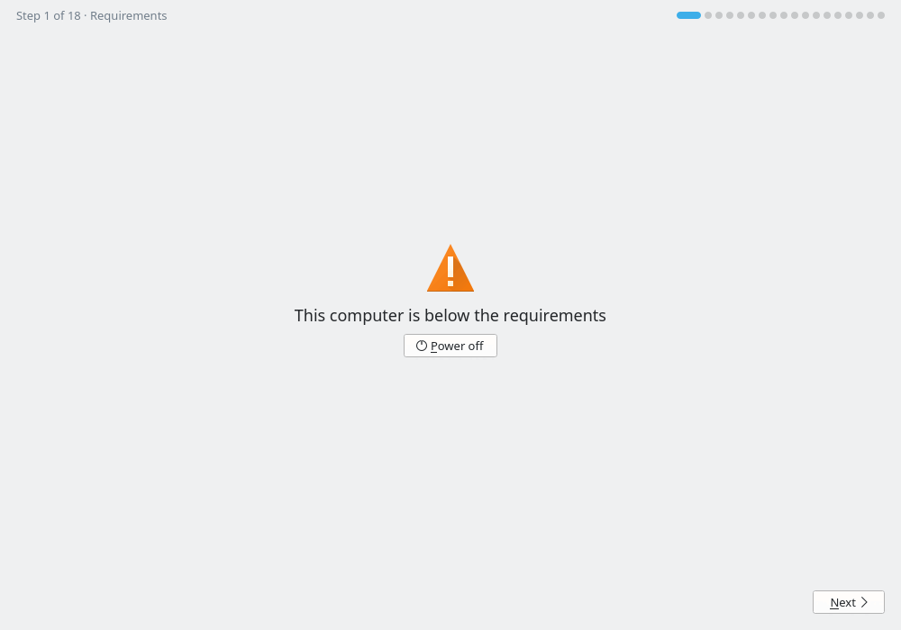

<div align="center">
    
    <h1>TunaOS installer</h1>
    <p>Native installers that put a <a href="https://bootc-dev.github.io/bootc/">bootc</a> image on a disk.<br>One frontend for each desktop, one backend, your brand.</p>
    <hr />
</div>

This repository was `tuna-os/bootc-installer` until 2026-11-25.
The old links redirect.

A bootc image is a container image that boots.
This repository has the programs that put such an image on a disk: a wizard for each desktop, and the contracts that the wizards share.
[fisherman](https://github.com/tuna-os/fisherman) writes the disk.

<p align="center">
  
</p>

## Frontends

| Desktop | Path | Toolkit | Walkthrough |
|---|---|---|---|
| KDE Plasma | [`frontends/kde/`](frontends/kde/README.md) | Qt 6 and Kirigami (C++) | [Screens](frontends/kde/docs/gui-walkthrough.md) |
| COSMIC | [`frontends/cosmic/`](frontends/cosmic/README.md) | libcosmic (Rust) | [Screens](frontends/cosmic/docs/gui-walkthrough.md) |
| niri | [`frontends/niri/`](frontends/niri/README.md) | Quickshell QML and Go | [Screens](frontends/niri/docs/gui-walkthrough.md) |
| XFCE | [`frontends/xfce/`](frontends/xfce/README.md) | GTK 3 (Python) | [Screens](frontends/xfce/docs/gui-walkthrough.md) |
| GNOME, Pantheon and Tuna | In tunaOS, not here | gnome-setup from upstream | [Architecture](docs/architecture.md#gnome-setup) |
| GNOME (legacy) | `bootc_installer/` | GTK 4 and libadwaita (Python) | [Screens](docs/gui-walkthrough.md) |

The first four have a page for each of the [eighteen shared screens](shared/flow/README.md).
[`docs/walkthrough/`](docs/walkthrough/README.md) shows all frontends in this repository side by side.
[`docs/PARITY.md`](docs/PARITY.md) shows what each does.

## Two install paths

| | Recipe path (legacy) | Daemon path |
|---|---|---|
| State | Live ISOs and the Flatpaks use it today | Not published. [The test state](docs/image-medium.md) shows what works |
| Backend | `fisherman`, with a JSON recipe | `fishermand`, over Varlink |
| Encryption | Optional | Always |

The native frontends use the daemon when its socket is there, else the recipe path.
[Architecture](docs/architecture.md) has the interfaces and what is legacy.

> [!WARNING]
> An install erases the disk that you select.
> Make a backup of your data before you start.
> The confirm screen shows the disk and the data that the install removes.

## Install

The live ISO of your distribution starts the installer.
The only bundle in a [release](https://github.com/tuna-os/installer/releases/latest) is the legacy GNOME frontend:

```bash
curl -Lo installer.flatpak \
  https://github.com/tuna-os/installer/releases/latest/download/org.bootcinstaller.Installer.flatpak
sudo flatpak install --bundle -y installer.flatpak
flatpak run org.bootcinstaller.Installer
```

The other frontends are in the [TunaOS Flatpak remote](docs/guide/installing.md).
The images are in `ghcr.io/tuna-os/bootc-installer`. That package keeps its name.

## Guidebook

| Page | Contents |
|---|---|
| [Install and use the installer](docs/guide/installing.md) | Get a frontend, and what each screen does |
| [Architecture](docs/architecture.md) | Frontends, fishermand, Varlink interfaces, gnome-setup, what is legacy |
| [The image-based medium](docs/image-medium.md) | What it is, and its test state |
| [How a recipe install works](docs/guide/how-it-works.md) | The steps of fisherman, encryption and first boot |
| [Recipes and autoinstall](docs/guide/recipes.md) | Recipe examples, field reference and unattended install |
| [Customise the installer for your image](docs/guide/customising.md) | Your catalog, defaults and brand |
| [Build, test and release](docs/guide/developing.md) | Build, test and the release flow |
| [Release flow](docs/RELEASE.md) | How `dev` gets to `prod` |

## Contribute

Read the [contribution guide](CONTRIBUTING.md) and [Build, test and release](docs/guide/developing.md).
Open pull requests against `dev`.

<!-- hive-contribute-plea: donated-compute appeal, keep in sync across repos -->
## Contribute compute — no code needed

**[Donate time with your AI CLI](https://hub.tunaos.org/#contribute).**

Your machine runs one task at a time using your signed-in AI coding CLI.
The relay alternates between eligible **School** (OS) and **Reef** (apps)
hives after each task. If one hive has no work, the other can continue.

The guide covers prerequisites, verified `just` setup, credentials, provider
costs, and how to stop with Ctrl+C. Your subscription quota or API charges apply.
Never post account credentials or API keys in issues or pull requests.
