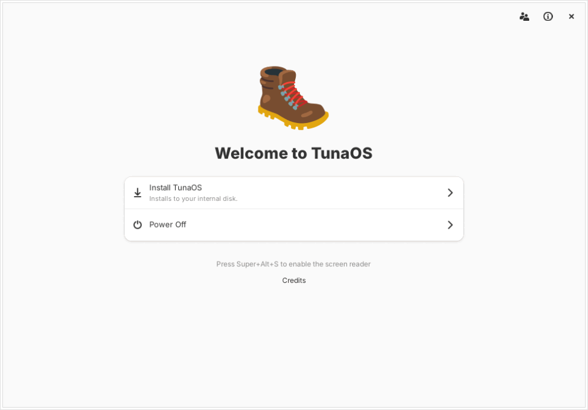

<div align="center">
    
    <h1>bootc-installer</h1>
    <p>Graphical installers that put a <a href="https://bootc-dev.github.io/bootc/">bootc</a> container image on a disk.<br>One backend, five desktop frontends, your brand.</p>
    <hr />
</div>

bootc-installer installs an operating system that ships as a bootc container image.
A wizard asks for a disk, an encryption mode and a user account.
Then the [fisherman](https://github.com/tuna-os/fisherman) backend partitions the disk, installs the image and prepares the first boot.

<p align="center">
  
</p>

## Why you need it

A bootc image is a container image that boots.
You build it with a `Containerfile`, and you update a computer with `bootc upgrade`.
But a container image is not on a disk until something puts it there.

bootc has commands for that step: `bootc install to-disk` and `bootc install to-filesystem`.
They are command-line tools for an administrator.
A person who downloads your live ISO needs more than a command:

- A wizard in the style of the desktop that the ISO starts.
- A check that the computer has enough RAM, a usable disk and UEFI.
- Disk encryption with a passphrase or the TPM, and a recovery key.
- A user account and a hostname.
- A progress bar, a log when the install fails, and a restart button.
- An install with no network, from the image on the ISO.

bootc-installer supplies these parts.
You supply the image.

## Who it is for

| You are | You get |
|---|---|
| The builder of a bootc image | An installer for your live ISO. You set the name, the artwork, the text and the image catalog in `/etc/bootc-installer/`. You do not fork the code. Refer to [Customise the installer for your image](docs/guide/customising.md). |
| The maintainer of a desktop spin | A frontend in the toolkit of your desktop: GNOME, KDE Plasma, COSMIC, Niri or XFCE. All five drive the same backend with the same recipe. |
| A person with a computer | The installer on the live ISO of your distribution. You can also run it as a Flatpak on a Linux system that you have now. |
| An administrator | An unattended install from a JSON recipe. Refer to [Recipes and autoinstall](docs/guide/recipes.md). |

> [!WARNING]
> An install erases the disk that you select.
> Make a backup of your data before you start.
> The confirm screen shows the disk and the data that the install removes.

## Install

```bash
curl -Lo installer.flatpak \
  https://github.com/tuna-os/bootc-installer/releases/latest/download/org.bootcinstaller.Installer.flatpak \
  && sudo flatpak uninstall -y org.bootcinstaller.Installer org.bootcos.Installer 2>/dev/null; sudo flatpak install --bundle -y installer.flatpak
flatpak run org.bootcinstaller.Installer
```

For the devel build and a tour of each screen, refer to [Install and use the installer](docs/guide/installing.md).

## Features

- **Two boot stacks.** systemd-boot with composefs for sealed images such as [Dakota](https://github.com/projectbluefin/dakota). GRUB2 for images such as Bluefin and Bazzite. The partition layout follows the boot stack.
- **Disk encryption.** LUKS2 with a passphrase, with the TPM2, or with the two together. For a TPM-only install, the installer shows a recovery key and holds the restart until you confirm it.
- **An image catalog.** Each frontend lists the images in fisherman's catalog, or in the catalog that your ISO ships.
- **A user account**, when the image needs one. The account is an administrator.
- **A hardware check.** The installer reads RAM, CPU, UEFI, TPM and disks from `fisherman probe`, and tells you what does not qualify.
- **Offline install.** On a live ISO, the installer uses the image on the media and does not use the network.
- **Fast first boot.** The backend copies the Wi-Fi and Bluetooth setup from the live session, and fills the caches.
- **Your brand.** A `branding.json` file sets the product name, the text and the artwork. The code has no product name.
- **Unattended install** (GNOME and XFCE). `--autoinstall` reads a JSON recipe and does not show the wizard.
- **A phone companion** (GNOME, COSMIC and XFCE). Scan a QR code and type your account data on a phone.

The frontends do not have all features yet, and some features have open defects.
[`docs/PARITY.md`](docs/PARITY.md) shows what each frontend does and links the issues.
The installer does not set the language, the keyboard layout or the time zone of the new system yet.

## How it works

```
 frontend (wizard)  ──recipe JSON on stdin──▶  fisherman (root)  ──▶  disk
        ▲                                            │
        └──────── progress as JSON lines ────────────┘
```

1. The frontend asks `fisherman probe --json` for the disks and the hardware.
2. The frontend checks each field with `fisherman validate` while you type.
3. The frontend writes the recipe to the standard input of fisherman. No file holds the recipe, because the recipe contains the passphrase and the password.
4. fisherman partitions the disk, encrypts it, runs `bootc install to-filesystem` and configures the new system.
5. The frontend shows the progress, then the recovery key and the restart button.

In a Flatpak, the frontend starts fisherman on the host with `flatpak-spawn --host pkexec`.
[How an install works](docs/guide/how-it-works.md) gives each step.

## Guidebook

The [guidebook](docs/guide/README.md) has the full documentation:

| Page | Contents |
|---|---|
| [Install and use the installer](docs/guide/installing.md) | Production and devel builds, and the wizard screen by screen |
| [How an install works](docs/guide/how-it-works.md) | Boot stacks, the install steps, encryption and first boot |
| [Recipes and autoinstall](docs/guide/recipes.md) | Recipe examples, field reference and unattended install |
| [Customise the installer for your image](docs/guide/customising.md) | Your own catalog and defaults in `/etc/bootc-installer/`, and new catalog images |
| [Build, test and release](docs/guide/developing.md) | Build, demo mode, tests, screenshots and the release flow |

## Frontends

This repository holds all five frontends.
They share the fisherman backend, the recipe schema and the screen contract in [`shared/`](shared/).
CI renders all five frontends in [`docs/walkthrough/`](docs/walkthrough/README.md).

On a live ISO, each frontend starts fisherman on the host.
The file `/etc/bootc-installer/live-iso-mode` tells fisherman that the image is on the media.
fisherman then checks the image on the media before it reads a disk or uses the network.
[`docs/live-iso.md`](docs/live-iso.md) tells you how to build such an ISO.

fisherman is a git submodule.
Every Flatpak builds fisherman from that submodule, so the gitlink is the only pin.
The four frontend manifests use the shared module `shared/flatpak/fisherman.json`.
Renovate keeps the gitlink current.
To move it by hand, run `shared/ci/fisherman_pins.py`.

| Frontend | Path | Toolkit | Walkthrough |
|---|---|---|---|
| GNOME | `bootc_installer/` | GTK4 / libadwaita (Python) | [docs/gui-walkthrough.md](docs/gui-walkthrough.md) |
| KDE Plasma | `frontends/kde/` | Qt 6 / Kirigami | [frontends/kde/docs/gui-walkthrough.md](frontends/kde/docs/gui-walkthrough.md) |
| COSMIC | `frontends/cosmic/` | libcosmic (Rust) | [frontends/cosmic/docs/gui-walkthrough.md](frontends/cosmic/docs/gui-walkthrough.md) |
| Niri | `frontends/niri/` | Quickshell QML + Go | [frontends/niri/docs/gui-walkthrough.md](frontends/niri/docs/gui-walkthrough.md) |
| XFCE | `frontends/xfce/` | GTK3 / PyGObject | [frontends/xfce/docs/gui-walkthrough.md](frontends/xfce/docs/gui-walkthrough.md) |

CI moves a release from `dev` to `prod` when all checks pass: [`docs/RELEASE.md`](docs/RELEASE.md).
For the merge of the old repositories, refer to [`docs/MIGRATION.md`](docs/MIGRATION.md).

## Contribute

Read the [contribution guide](CONTRIBUTING.md) and [Build, test and release](docs/guide/developing.md).
Open pull requests against `dev`.

<!-- hive-contribute-plea: donated-compute appeal, keep in sync across repos -->
## Contribute compute — no code needed

**[Donate time with your AI CLI](https://hub.tunaos.org/#contribute).**

Your machine runs one task at a time using your signed-in AI coding CLI.
The relay alternates between eligible **School** (OS) and **Reef** (apps)
hives after each task. If one hive has no work, the other can continue.

The guide covers prerequisites, verified `just` setup, credentials, provider
costs, and how to stop with Ctrl+C. Your subscription quota or API charges apply.
Never post account credentials or API keys in issues or pull requests.
