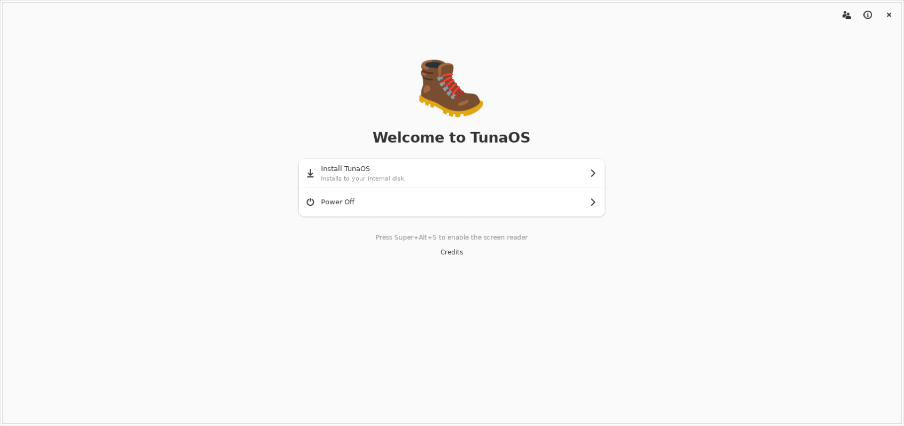

<div align="center">
    
    <h1>bootc-installer</h1>
    <p>A GTK 4 / Libadwaita Flatpak installer for <a href="https://projectbluefin.io">Project Bluefin</a> and other <a href="https://universal-blue.org">Universal Blue</a> bootc images.</p>
    <hr />
</div>

bootc-installer is a graphical installer for [bootc](https://containers.github.io/bootc/) container images.
It partitions and encrypts the disk, installs the image and prepares the first boot.

<p align="center">
  
</p>

<!-- hive-contribute-plea: donated-compute appeal, keep in sync across repos -->
## Contribute compute — no code needed

**[Donate time with your AI CLI](https://hub.tunaos.org/#contribute).**

Your machine runs one task at a time using your signed-in AI coding CLI.
The relay alternates between eligible **School** (OS) and **Reef** (apps)
hives after each task. If one hive has no work, the other can continue.

The guide covers prerequisites, verified `just` setup, credentials, provider
costs, and how to stop with Ctrl+C. Your subscription quota or API charges apply.
Never post account credentials or API keys in issues or pull requests.

## Install

```bash
curl -Lo installer.flatpak \
  https://github.com/tuna-os/bootc-installer/releases/latest/download/org.bootcinstaller.Installer.flatpak \
  && sudo flatpak uninstall -y org.bootcinstaller.Installer org.bootcos.Installer 2>/dev/null; sudo flatpak install --bundle -y installer.flatpak
flatpak run org.bootcinstaller.Installer
```

For the devel build and a tour of each screen, refer to [Install and use the installer](docs/guide/installing.md).

## Features

- Two boot stacks: systemd-boot with composefs for [Dakota](https://github.com/projectbluefin/dakota), and GRUB2 for Bluefin, Bluefin-LTS and Bazzite.
- LUKS2 encryption with a passphrase, TPM2, or the two together.
- Fast first boot: Wi-Fi, Bluetooth, audio names, printers and warm caches.
- A phone companion: scan a QR code and type your account data on a phone.
- Offline install from a live ISO.
- Unattended install from a JSON recipe with `--autoinstall`.

## Guidebook

The [guidebook](docs/guide/README.md) has the full documentation:

| Page | Contents |
|---|---|
| [Install and use the installer](docs/guide/installing.md) | Production and devel builds, and the wizard screen by screen |
| [How an install works](docs/guide/how-it-works.md) | Boot stacks, the nine install steps, encryption and first boot |
| [Recipes and autoinstall](docs/guide/recipes.md) | Recipe examples, field reference and unattended install |
| [Customise the installer for your image](docs/guide/customising.md) | Your own catalog and defaults in `/etc/bootc-installer/`, and new catalog images |
| [Build, test and release](docs/guide/developing.md) | Build, demo mode, tests, screenshots and the release flow |

## Frontends

This repository is the monorepo for all TunaOS and Bluefin installer frontends.
They share the fisherman backend, the recipe schema and the screen contract in [`shared/`](shared/).
CI renders all five frontends in [`docs/walkthrough/`](docs/walkthrough/README.md).

| Frontend | Path | Toolkit | Walkthrough |
|---|---|---|---|
| GNOME | `bootc_installer/` | GTK4 / libadwaita (Python) | [docs/gui-walkthrough.md](docs/gui-walkthrough.md) |
| KDE Plasma | `frontends/kde/` | Qt 6 / Kirigami | [frontends/kde/docs/gui-walkthrough.md](frontends/kde/docs/gui-walkthrough.md) |
| COSMIC | `frontends/cosmic/` | libcosmic (Rust) | [frontends/cosmic/docs/gui-walkthrough.md](frontends/cosmic/docs/gui-walkthrough.md) |
| Niri | `frontends/niri/` | Quickshell QML + Go | [frontends/niri/docs/gui-walkthrough.md](frontends/niri/docs/gui-walkthrough.md) |
| XFCE | `frontends/xfce/` | GTK3 / PyGObject | [frontends/xfce/docs/gui-walkthrough.md](frontends/xfce/docs/gui-walkthrough.md) |

CI moves a release from `dev` to `prod` when all checks pass: [`docs/RELEASE.md`](docs/RELEASE.md).
For the merge of the old repositories, refer to [`docs/MIGRATION.md`](docs/MIGRATION.md).

## Contribute

Read the [contribution guide](CONTRIBUTING.md) and [Build, test and release](docs/guide/developing.md).
Open pull requests against `dev`.
