# Install and use the installer

A live ISO starts the installer of its desktop by itself.
You can also run a frontend as a Flatpak on a Linux system.
A Flatpak uses the [recipe path](../architecture.md#the-recipe-path).

## Get a native frontend

The KDE, COSMIC, niri and XFCE frontends are in the TunaOS Flatpak remote.
[The Flatpak guide](https://tunaos.org/docs/flatpak/guide) tells you how to add it.

| Desktop | App ID |
|---|---|
| KDE Plasma | `org.tunaos.InstallerKde` |
| COSMIC | `org.tunaos.InstallerCosmic` |
| niri | `org.tunaos.InstallerNiri` |
| XFCE | `org.tunaos.InstallerXfce` |

## Get the legacy GNOME frontend

Live ISOs with GNOME use this frontend today.
This command removes an old copy, then installs the latest release:

```bash
curl -Lo installer.flatpak \
  https://github.com/tuna-os/installer/releases/latest/download/org.bootcinstaller.Installer.flatpak \
  && sudo flatpak uninstall -y org.bootcinstaller.Installer org.bootcos.Installer 2>/dev/null; sudo flatpak install --bundle -y installer.flatpak
```

The devel build follows the `dev` branch.
Use it to test new changes:

```bash
curl -Lo installer-devel.flatpak \
  https://github.com/tuna-os/installer/releases/download/latest-dev/org.bootcinstaller.Installer.Devel.flatpak \
  && sudo flatpak uninstall -y org.bootcinstaller.Installer.Devel 2>/dev/null; sudo flatpak install --bundle -y installer-devel.flatpak
```

The production release moves only when `dev` passes all checks.
Refer to [the release flow](../RELEASE.md).

## Start the installer

```bash
flatpak run org.bootcinstaller.Installer
```

On a live ISO, the installer starts by itself.

## The native frontends, screen by screen

The four native frontends have the same screens in the same order.
A screen that does not apply does not show.

| Screen | What you do |
|---|---|
| Requirements | See what the computer does not have. It shows only when a check fails. |
| Try or install | Use the live desktop, or start the install. |
| Language, keyboard, time zone | Select them for the live session and the new system. |
| Network | Connect. It shows only when the install downloads an image. |
| Disclaimer, terms of use | Read them. They show only when the image has them. |
| Intel RST | Read the warning when RST hides a disk. |
| Disk | Select the disk. |
| Existing data | Use the free space, or erase the disk (daemon path). |
| Encryption | Select how the disk unlocks. |
| Account | Type the name and the password of the first user. |
| Confirm | Make sure that the data is correct. The install writes to the disk after this screen. |
| Install | Wait, or cancel. |
| Recovery key | Keep the key in a safe place. You can scan a QR code. |
| Handoff | Read how the new system starts (daemon path). |
| Done | Restart. |

[The walkthrough](../walkthrough/README.md) has an image of each screen.

## The legacy GNOME wizard, screen by screen

The images below come from CI.
Refer to [the GNOME walkthrough](../gui-walkthrough.md) for the full set.

| Screen | What you do |
|---|---|
| 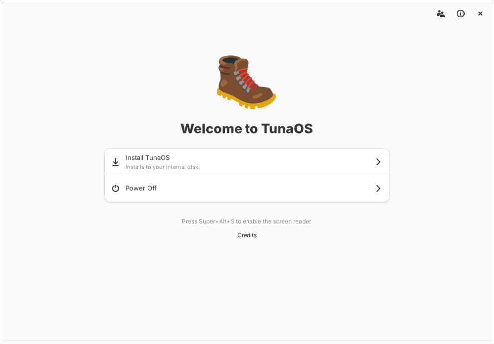 | **Welcome**. Read what the installer will do. |
| 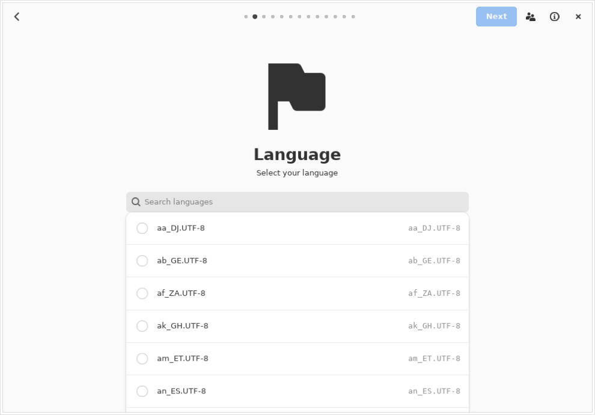 | **Language**. Select the language of the installed system. |
| 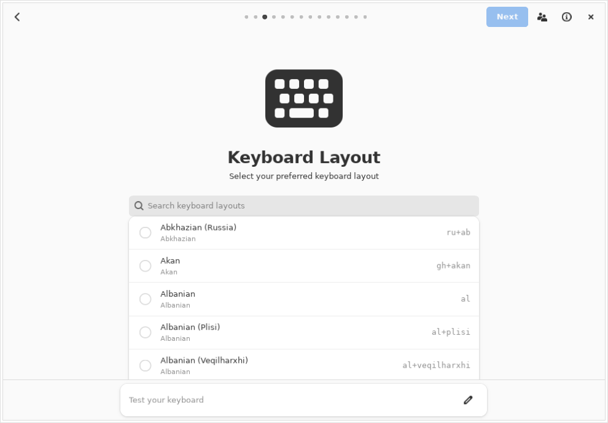 | **Keyboard**. Select the keyboard layout. |
| 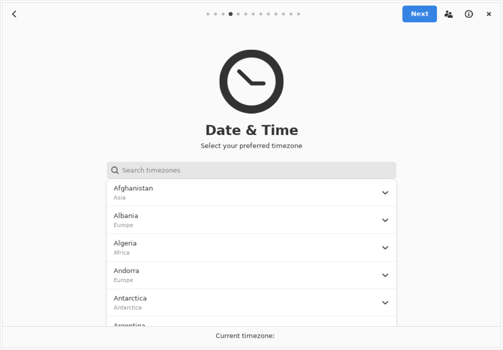 | **Time zone**. Select the time zone. |
| 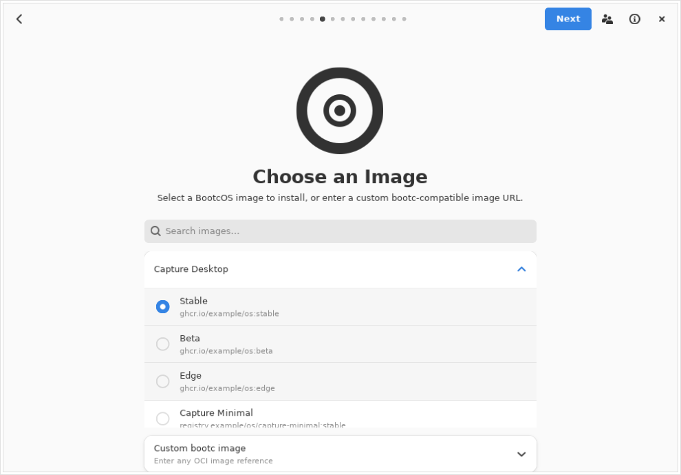 | **Image**. Select the image to install. |
| 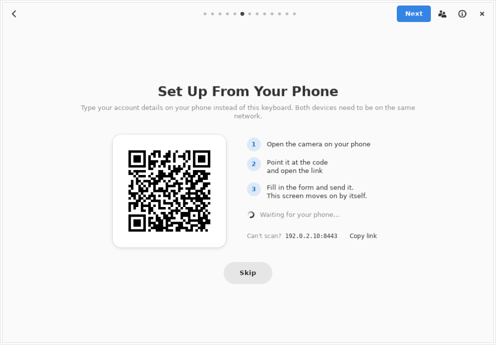 | **Phone companion**. Scan the QR code to type your account data on a phone. This step is optional. |
| 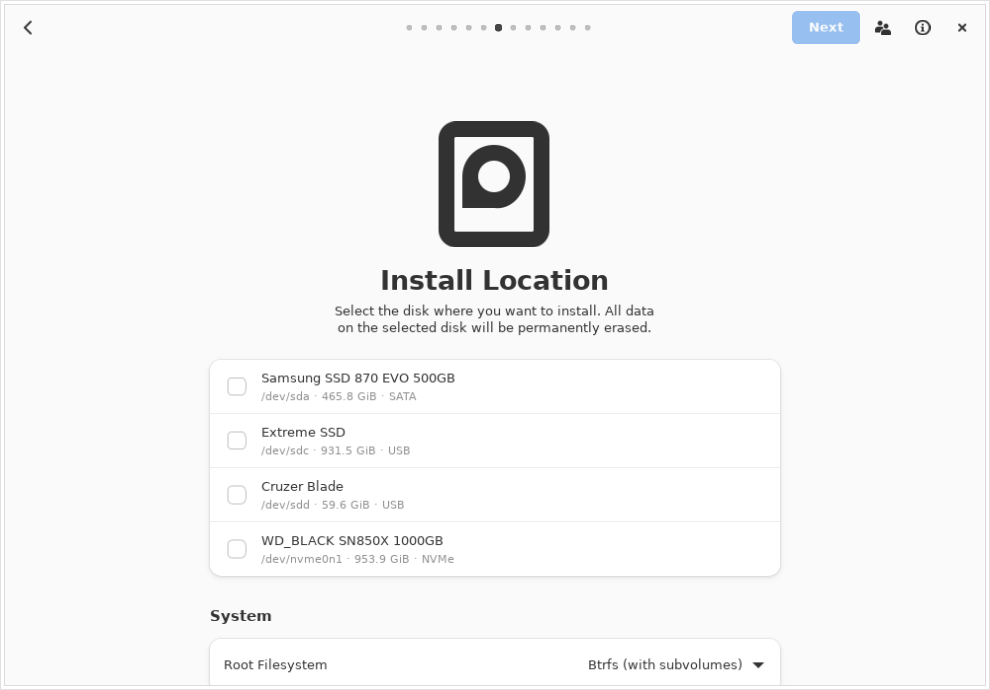 | **Install location**. Select a disk. The installer does not write to the disk yet. |
| 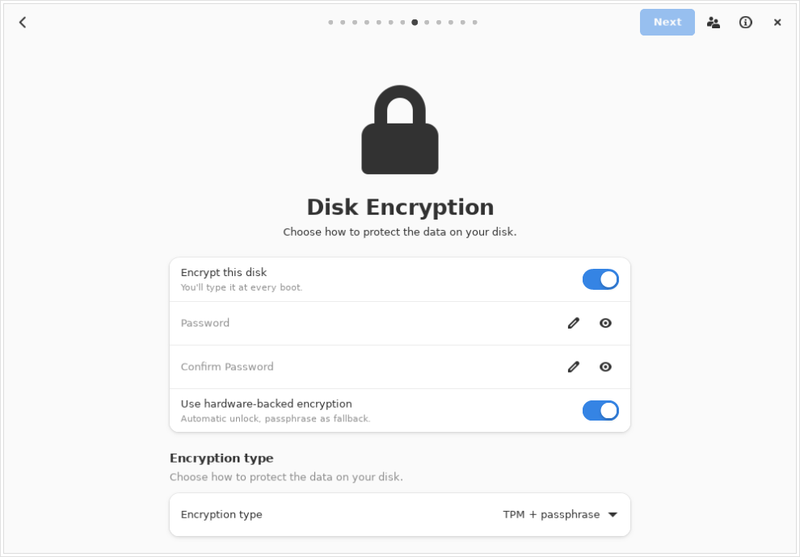 | **Disk encryption**. Select LUKS with a passphrase, TPM2, or the two together. |
| 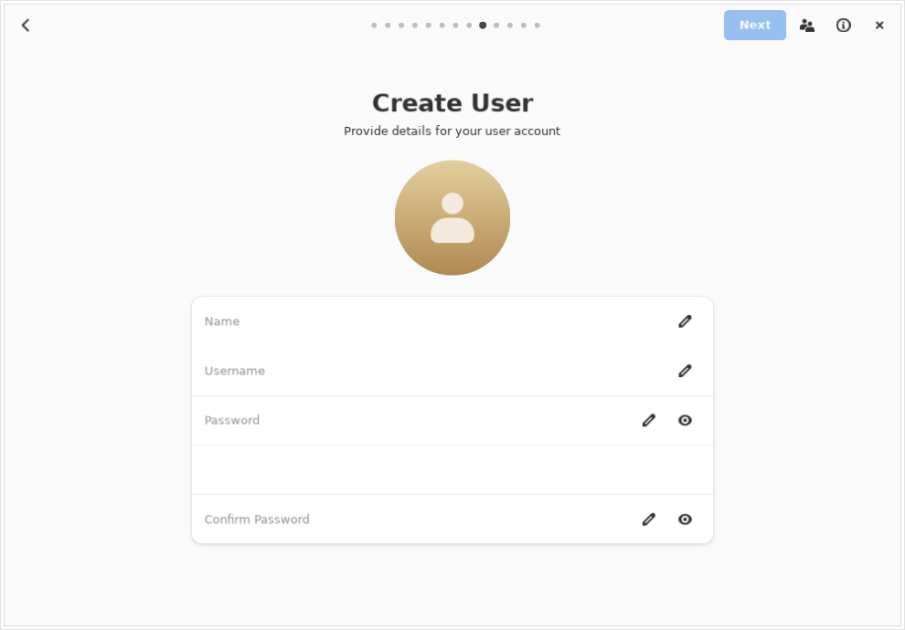 | **User account**. Type your name, user name and password. |
| 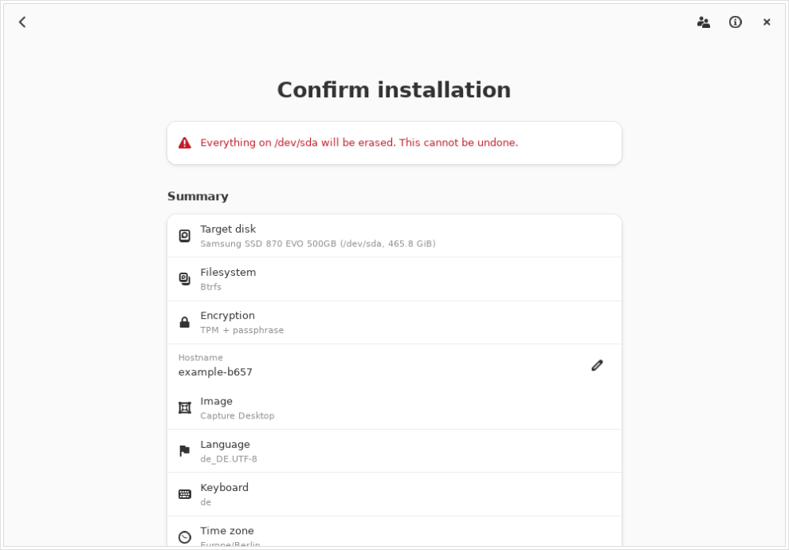 | **Confirm**. Make sure that the data is correct. After this screen, the installer writes to the disk. |
| 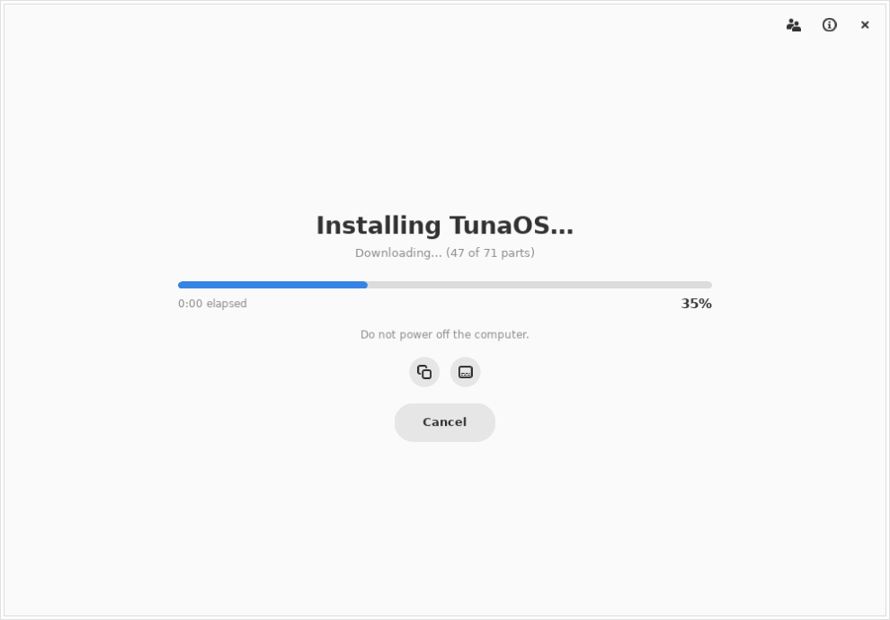 | **Installing**. Wait for the install steps to complete. Open the log if you want to see more. |
| 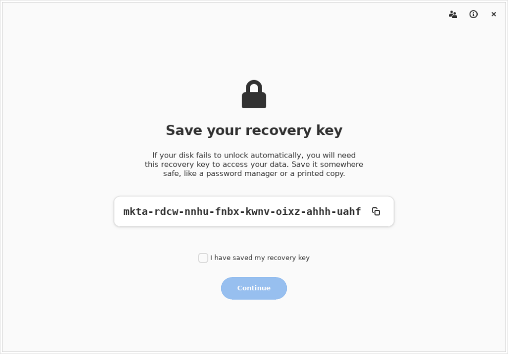 | **Recovery key**. Keep the key in a safe place, then confirm. This screen shows only after an encrypted install. |
| 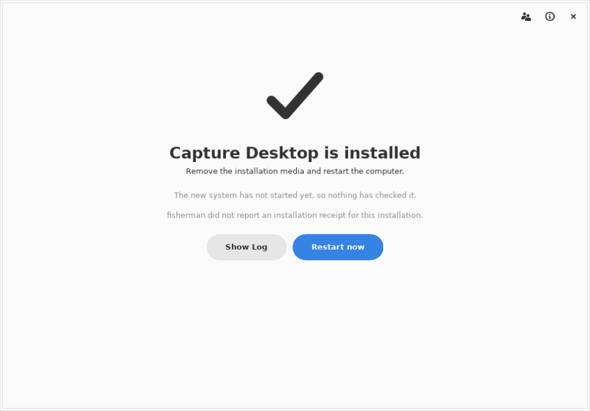 | **Done**. Restart into the new system. |

Some screens show only for some images.
For example, the account screen shows only when the image needs a user account.
