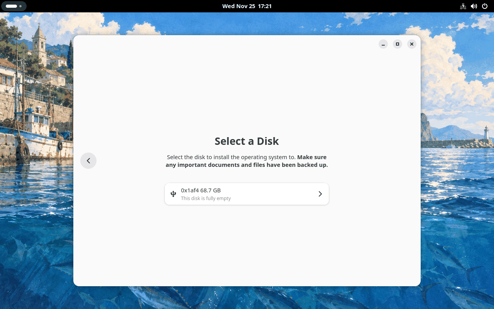
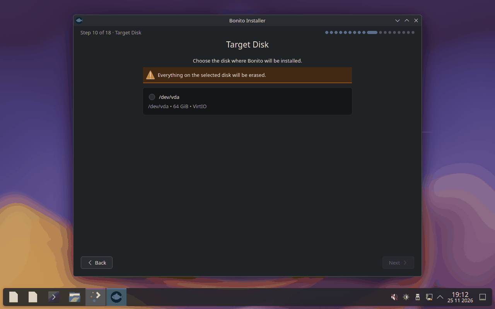
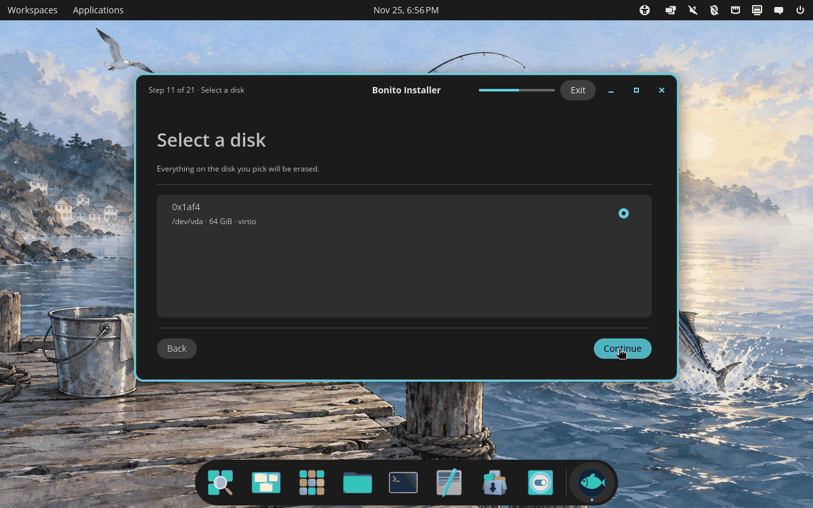
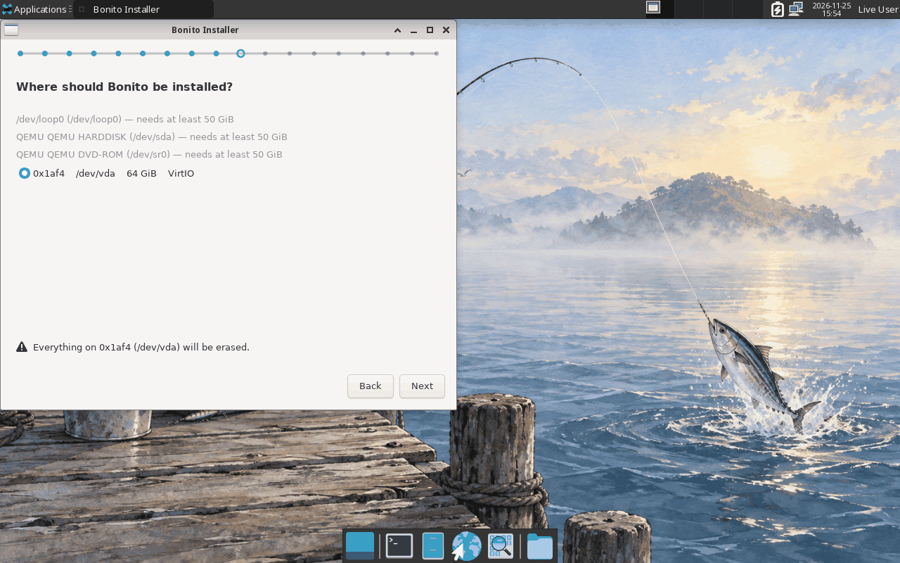

# The image-based medium

The image-based medium is the planned replacement for the live ISOs.
CI builds one disk image for each cell (a variant and a desktop), for example
`bonito:kde`. The image boots to a live desktop and starts the installer of
that desktop. `fishermand` then copies the system from the medium to the disk.
[Architecture](architecture.md) tells you how the parts talk.

> [!IMPORTANT]
> **You cannot download the medium yet.** CI publishes no image of it. The live
> ISOs use the recipe path. No cell has passed all seven test stages.

The code is in
[`installer-medium/`](https://github.com/tuna-os/tunaOS/tree/main/installer-medium)
of tunaOS. The work that the runs below tested is in the draft
[tunaOS#4964](https://github.com/tuna-os/tunaOS/pull/4964), not in `main`.

## Test state on 2026-11-25

The table shows the best result of each cell, as a person read it from the
screenshots. The runs are in Actions of tuna-os/tunaOS. Each run used a
virtual machine with a TPM and the USB boot path.

| Cell | Frontend | Run | 1 live boot | 2 pages | 3 install | 4 unlock and key | 5 first boot | 6 desktop and status | 7 switch and rollback |
|---|---|---|---|---|---|---|---|---|---|
| `bonito:kde` | KDE | [45671929202](https://github.com/tuna-os/tunaOS/actions/runs/45671929202) | pass | pass | pass | **fail**: the TPM unlocks the disk, but the recovery key is not saved | pass | pass | **fail**: no rollback |
| `bonito:cosmic` | COSMIC | [45669552583](https://github.com/tuna-os/tunaOS/actions/runs/45669552583) | pass | pass | pass | seen: the record says unverified | pass | pass | **fail**: no rollback |
| `albacore:gnome` | gnome-setup | [45651057509](https://github.com/tuna-os/tunaOS/actions/runs/45651057509) | pass | pass | pass | pass | not finished | not run | not run |
| `bonito:xfce` | XFCE | [45639909696](https://github.com/tuna-os/tunaOS/actions/runs/45639909696) | pass | pass | **fail** | not run | not run | not run | not run |
| `bonito:niri` | niri | [45651256265](https://github.com/tuna-os/tunaOS/actions/runs/45651256265) | **fail**: black screen | not run | not run | not run | not run | not run | not run |

Notes:

- **SELinux was permissive in the live session of each run**
  ([tunaOS#4973](https://github.com/tuna-os/tunaOS/issues/4973)). In the
  KDE and COSMIC runs, `getenforce` on the new system gave the enforcing mode.
- **A CD boot of a GRUB cell stops at the GRUB prompt**
  ([tunaOS#4970](https://github.com/tuna-os/tunaOS/issues/4970)).
- niri does not start on the software renderer of the CI runner. The test
  needs a GPU. Some runs recorded stage 1 as a pass, but each screenshot was
  black. Thus they do not count.
- The XFCE frontend asked for no encryption, and the daemon refused it.
  [#465](https://github.com/tuna-os/installer/pull/465) has the correction, and no run has tested it.
- The cells of Pantheon and Tuna have not run.

## Screenshots from the runs

These are the disk pages of the runs in the table. The only change is a
smaller colour palette.

| | |
|---|---|
|  gnome-setup, `albacore:gnome` |  KDE, `bonito:kde` |
|  COSMIC, `bonito:cosmic` |  XFCE, `bonito:xfce` |
