# GNOME (gnome-setup): installer walkthrough

Do not edit this page. `tools/walkthrough/render.py` makes it.

These pictures come from the real installer against the mock daemon (`fishermand --mock`). The mock writes to no disk. The machine, the disks and the recovery key are fixtures.

The main path in other forms: [1024 x 600](small/README.md).

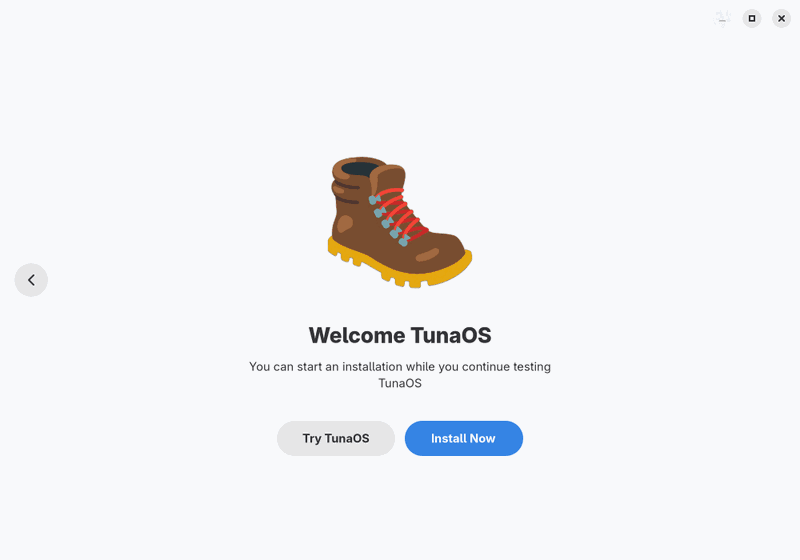

| # | Page | When it shows | Picture |
|---|---|---|---|
| 1 | Try or install | The wizard runs on live media. |  |
| 2 | Language | Always. | [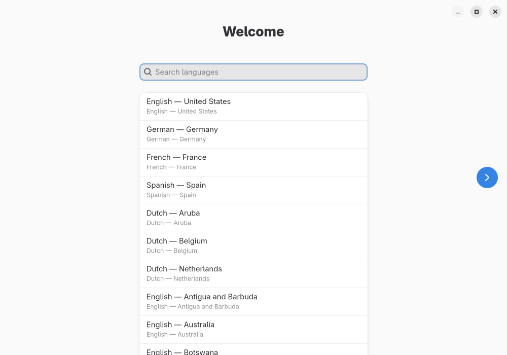](02-language.png) |
| 3 | Keyboard layout | Always. | [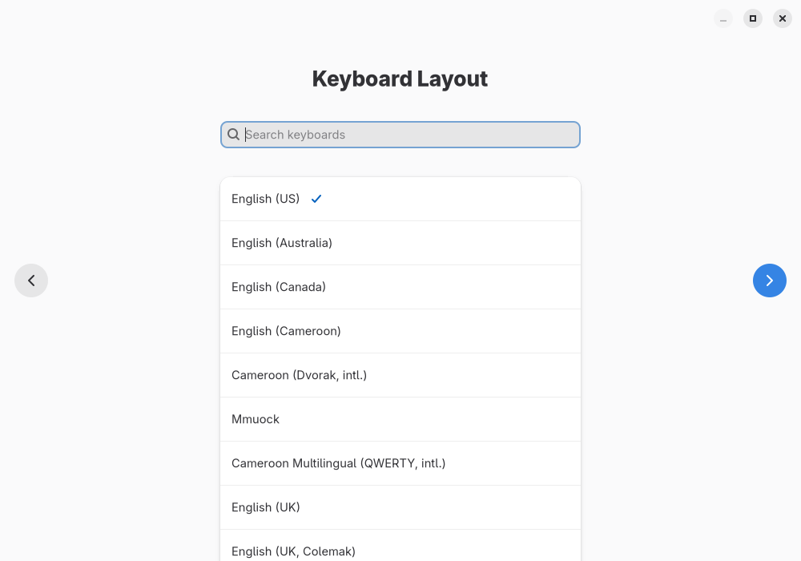](03-keyboard.png) |
| 4 | Disclaimer | os-release RELEASE_TYPE is `pre-release` or `experiment`. | [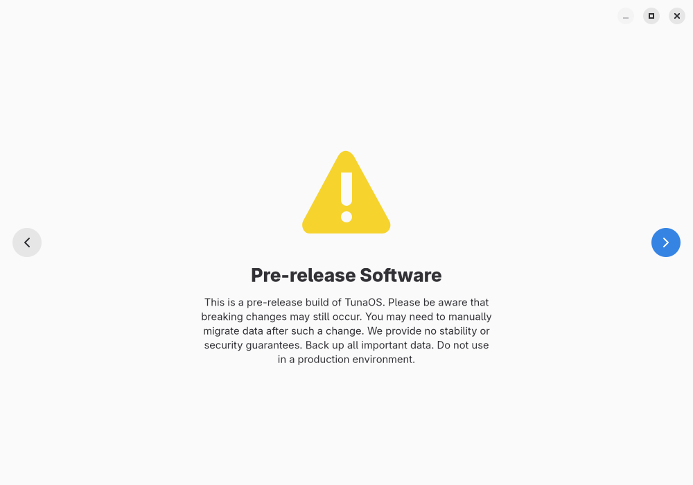](04-prerelease.png) |
| 5 | Terms of use | The image ships an AppStream component with an `agreement` of type `eula`. | [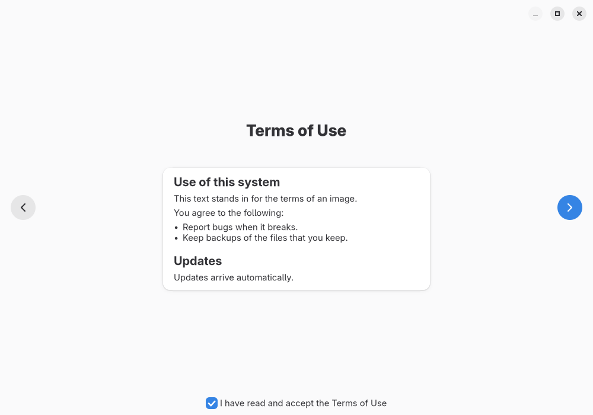](05-eula.png) |
| 6 | Disk | Always. | [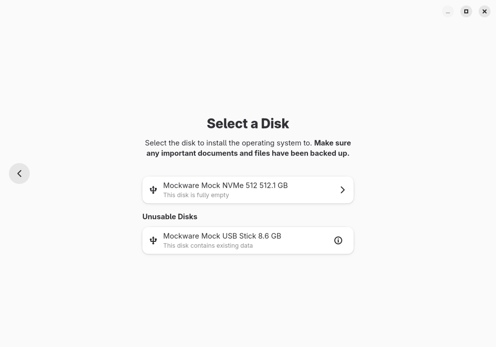](06-disk.png) |
| 7 | Disk: no usable disk | No disk. | [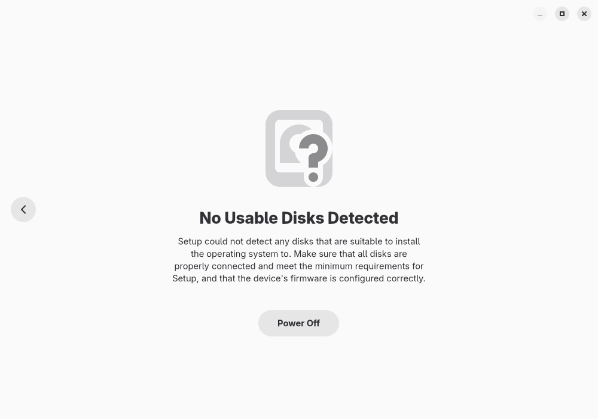](07-disk--no-usable-disk.png) |
| 8 | Existing data found | The chosen disk has status data-detected. | [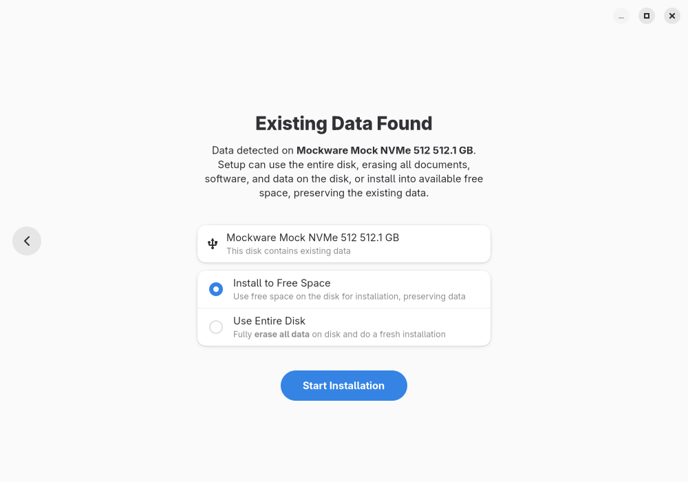](08-wipe-or-free.png) |
| 9 | Disk encryption | No TPM 2.0 is present. The page asks for a disk passphrase, twice. | [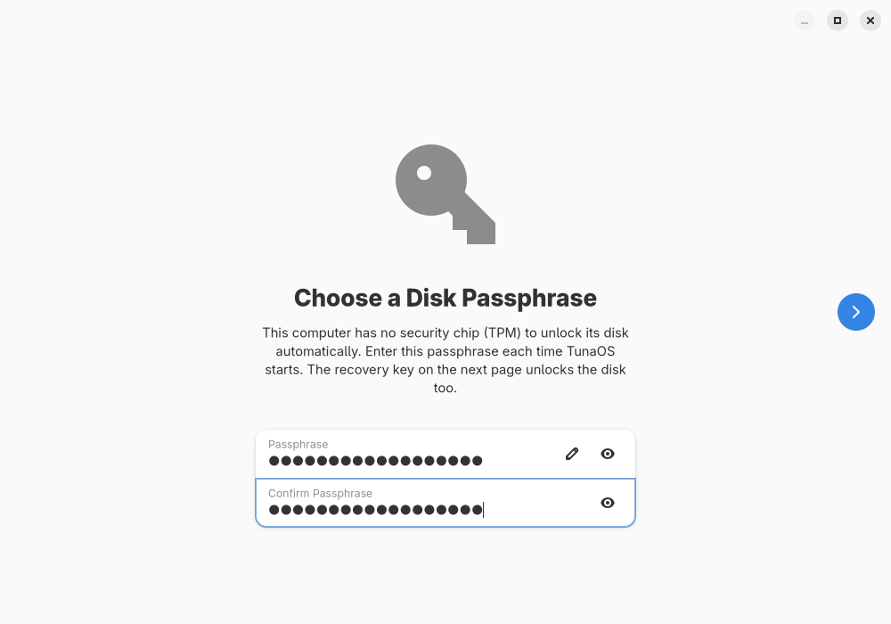](09-encryption.png) |
| 10 | Confirm | Always. | [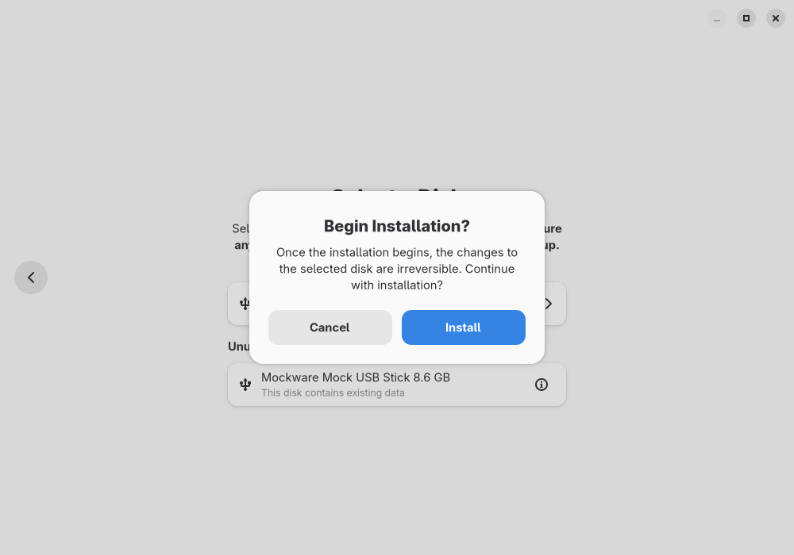](10-confirm.png) |
| 11 | Installing | After confirm. | [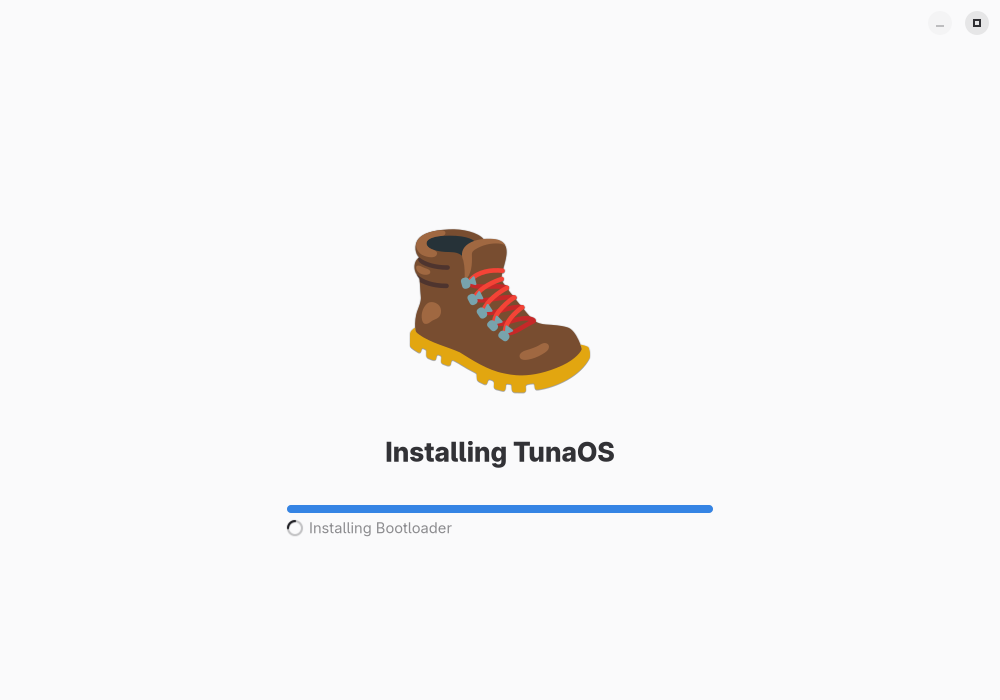](11-install.png) |
| 12 | Recovery key | The disk is encrypted. | [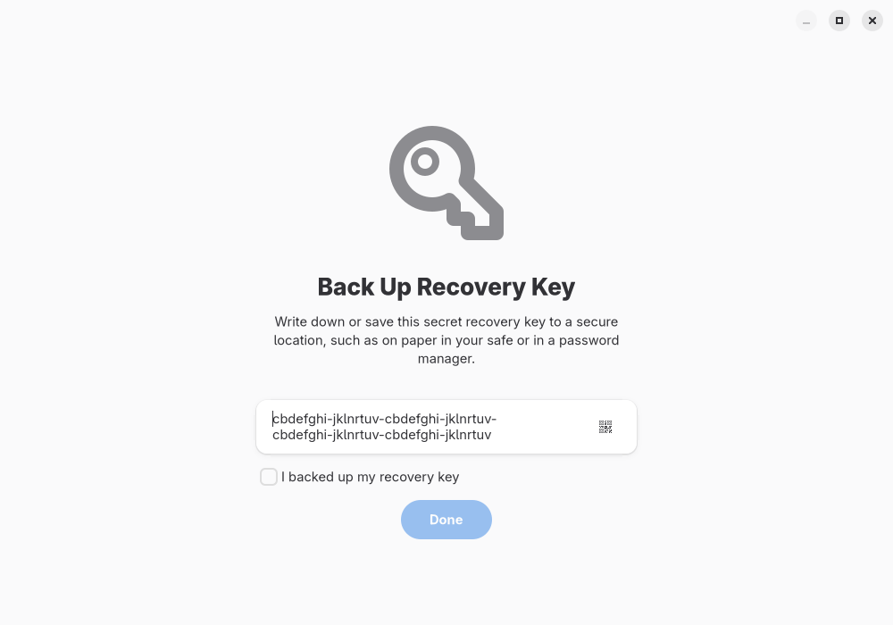](12-recovery-key.png) |
| 13 | Done | The install ended. | [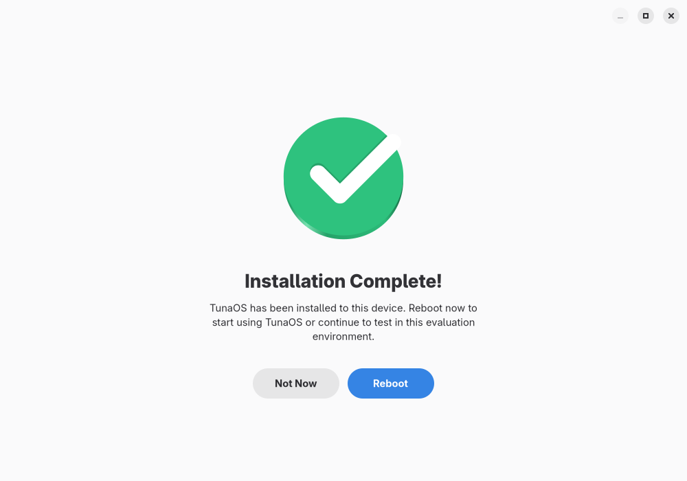](13-done.png) |

## Pages with no picture of their own

| Page | Reason |
|---|---|
| `install--cancel` | gnome-setup has no Cancel during the install. |
| `done--cancelled` | gnome-setup has no Cancel during the install. |
| `requirements` | gnome-setup has no such page. |
| `timezone` | gnome-initial-setup asks for it on the first boot. |
| `network` | gnome-initial-setup asks for it on the first boot. |
| `account` | gnome-initial-setup makes the account on the first boot. |
| `handoff` | gnome-setup restarts from its last page. |
| `rst` | gnome-setup reads Intel RST from sysfs, not from the daemon, and the session cannot change sysfs. |
| `handoff--soft-reboot` | gnome-setup has no handoff page. |
| `handoff--handoff-failed` | gnome-setup has no handoff page. |
| `requirements--requirements-fatal` | gnome-setup has no requirements page. |
| `done--device-lost` | gnome-setup goes on to the next page when the install fails (tuna-os/tunaOS#5017). |
| `recovery-key--recovery-key-failed` | gnome-setup shows no recovery-key page and no error when the daemon makes no key. |
| `encryption--passphrase-enroll-failed` | gnome-setup goes on when the daemon refuses the passphrase (tuna-os/tunaOS#5017). |
| `done--repart-error` | gnome-setup goes on to the next page when the install fails (tuna-os/tunaOS#5017). |
