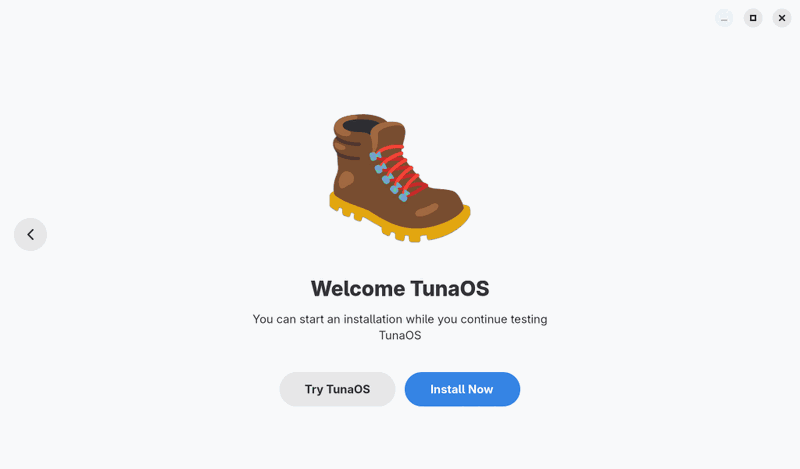
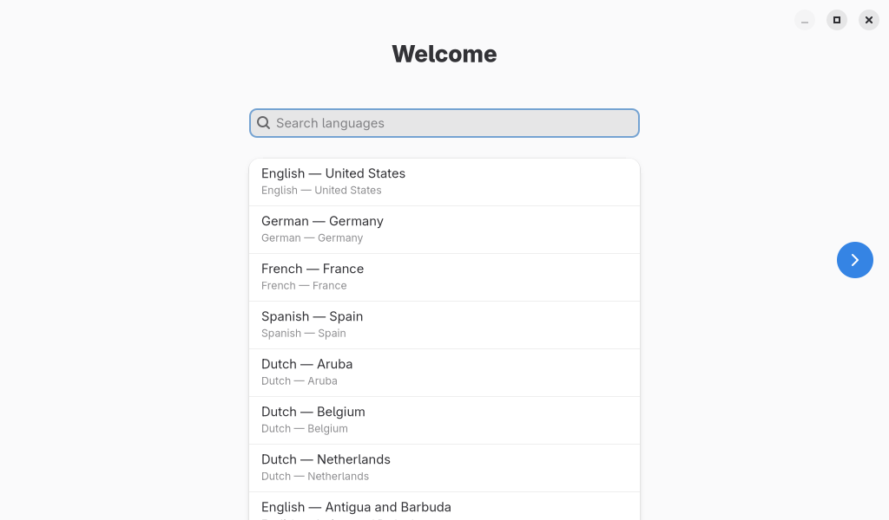
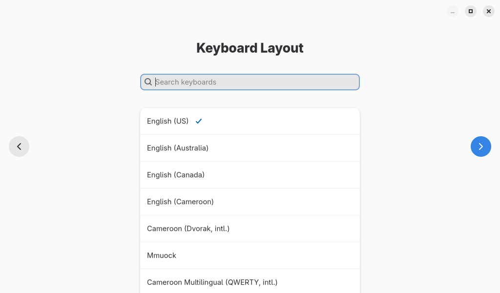
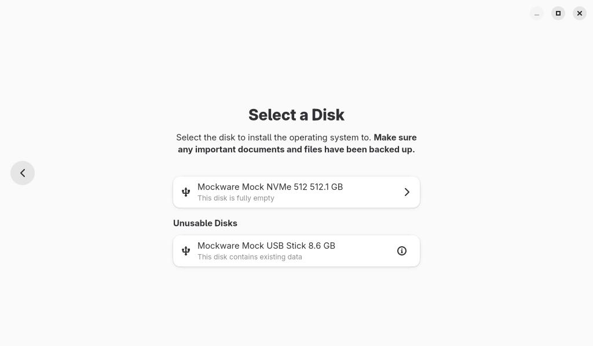
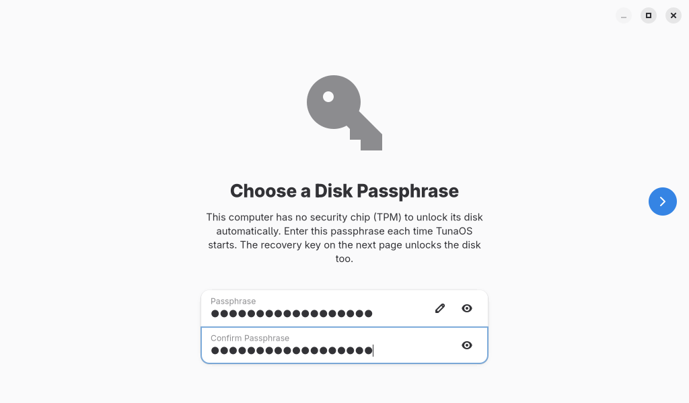
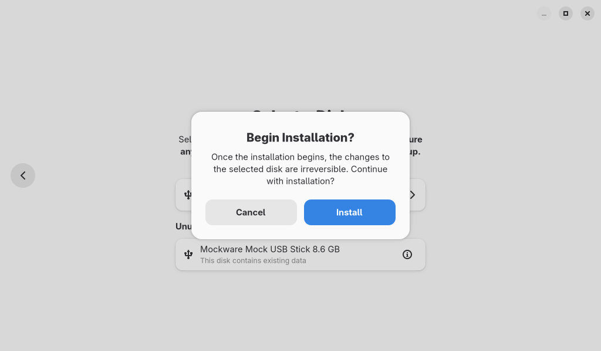
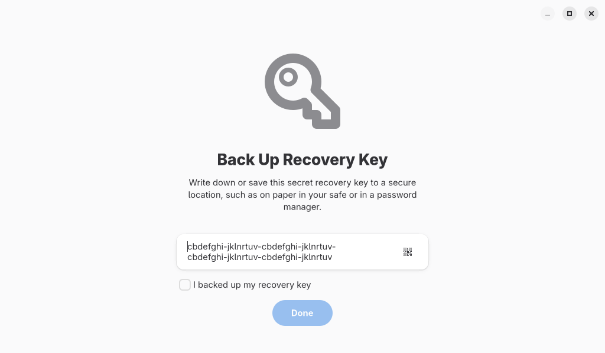
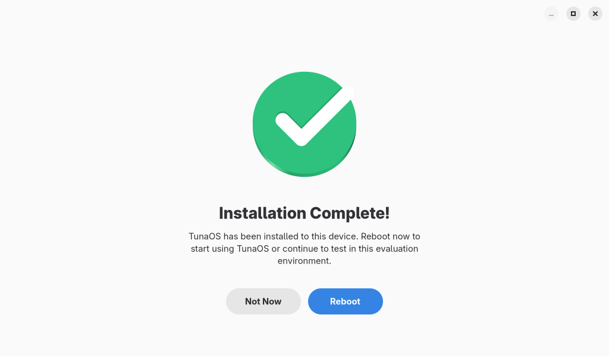

# GNOME (gnome-setup): installer walkthrough, 1024 x 600

Do not edit this page. `tools/walkthrough/render.py` makes it.

These pictures come from the real installer against the mock daemon (`fishermand --mock`). The mock writes to no disk. The machine, the disks and the recovery key are fixtures.

| # | Page | When it shows | Picture |
|---|---|---|---|
| 1 | Try or install | The wizard runs on live media. |  |
| 2 | Language | Always. |  |
| 3 | Keyboard layout | Always. |  |
| 4 | Disk | Always. |  |
| 5 | Disk encryption | No TPM 2.0 is present. The page asks for a disk passphrase, twice. |  |
| 6 | Confirm | Always. |  |
| 7 | Recovery key | The disk is encrypted. |  |
| 8 | Done | The install ended. |  |
