# KDE Plasma: installer walkthrough, 1024 x 600

Do not edit this page. `tools/walkthrough/render.py` makes it.

These pictures come from the real installer against the mock daemon (`fishermand --mock`). The mock writes to no disk. The machine, the disks and the recovery key are fixtures.

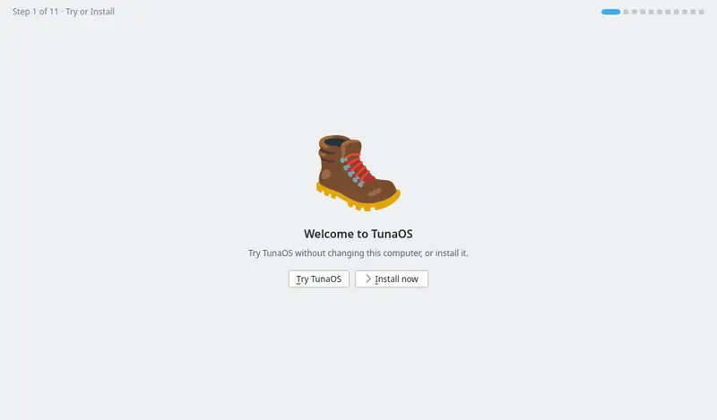

| # | Page | When it shows | Picture |
|---|---|---|---|
| 1 | Try or install | The wizard runs on live media. | [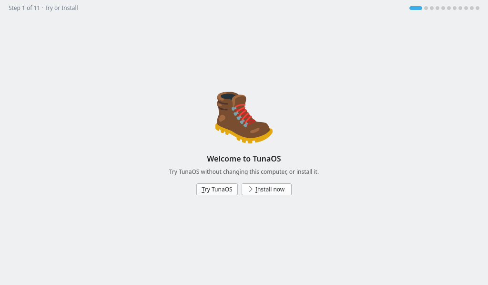](01-try-or-install.png) |
| 2 | Language | Always. | [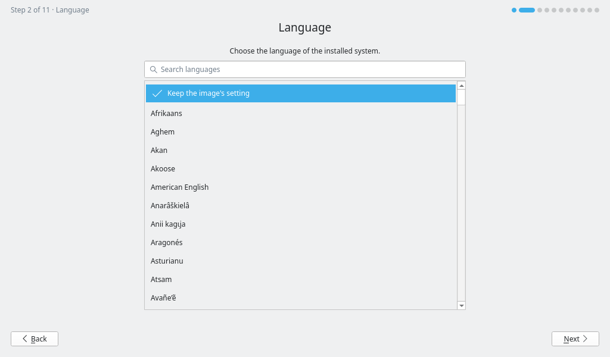](02-language.png) |
| 3 | Keyboard layout | Always. | [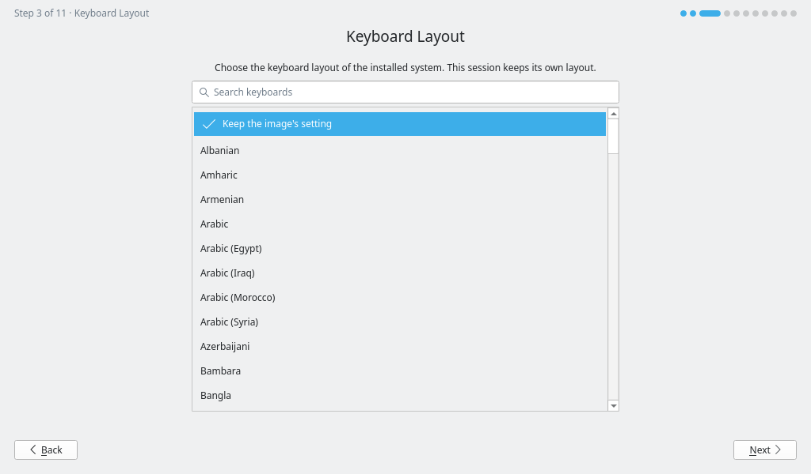](03-keyboard.png) |
| 4 | Time zone | Always. | [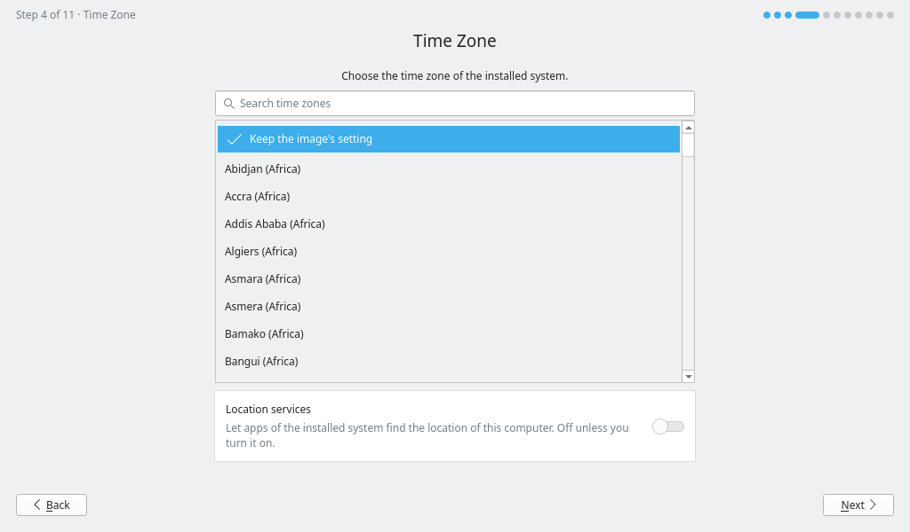](04-timezone.png) |
| 5 | Disk | Always. | [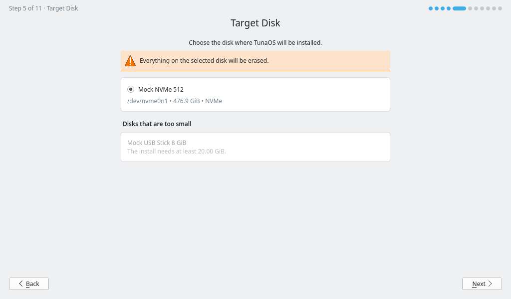](05-disk.png) |
| 6 | Account | The desktop has no first-boot tool that creates the user, and the image does not make its own user. | [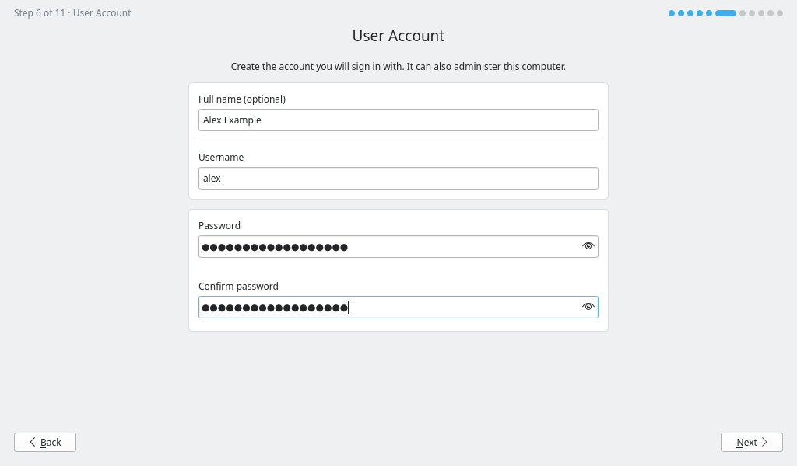](06-account.png) |
| 7 | Confirm | Always. | [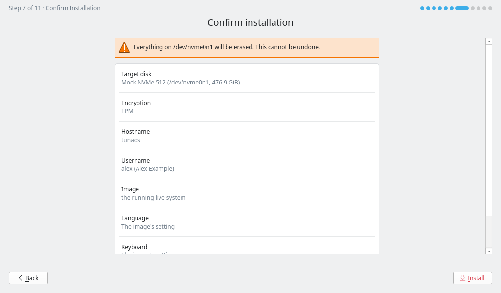](07-confirm.png) |
| 8 | Recovery key | The disk is encrypted. | [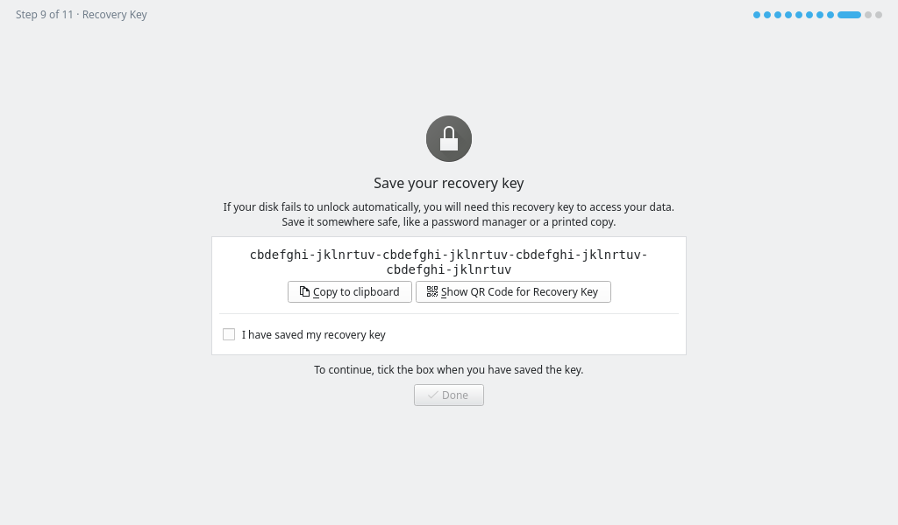](08-recovery-key.png) |
| 9 | Handoff | After the install and the recovery key. | [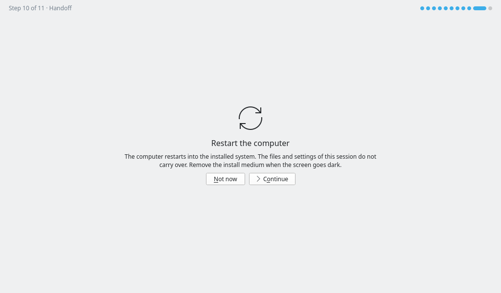](09-handoff.png) |
| 10 | Done | The install ended. | [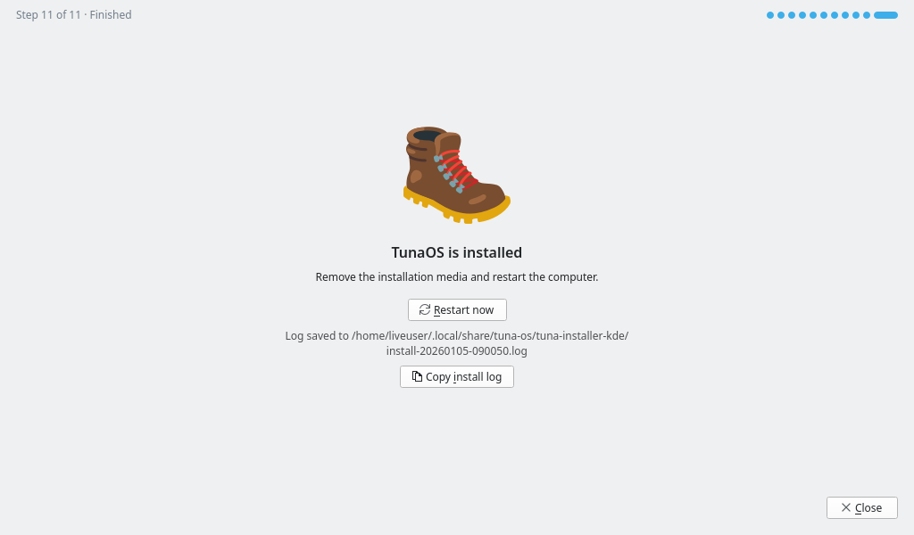](10-done.png) |
