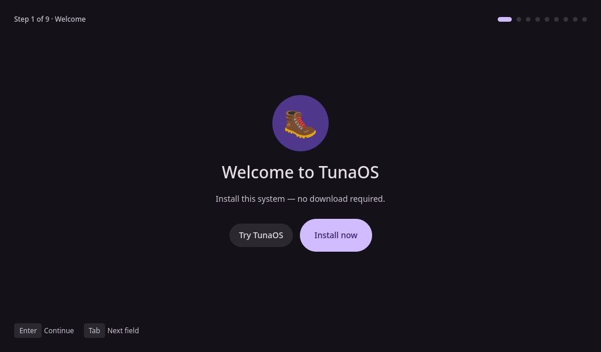
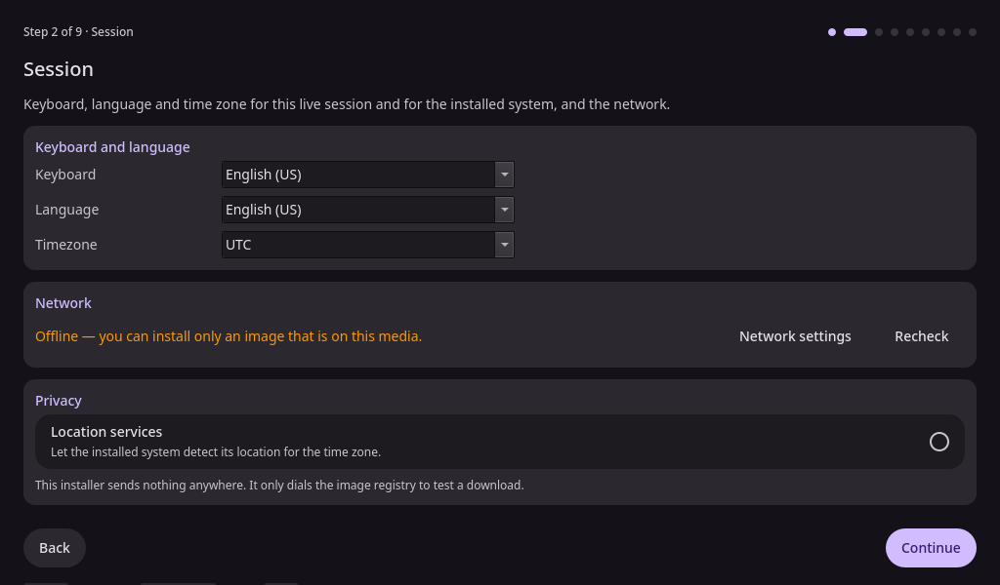
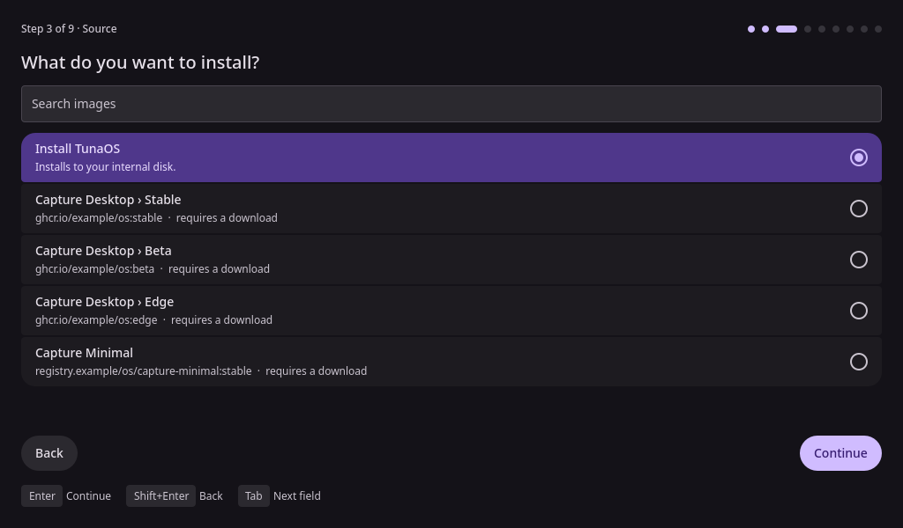
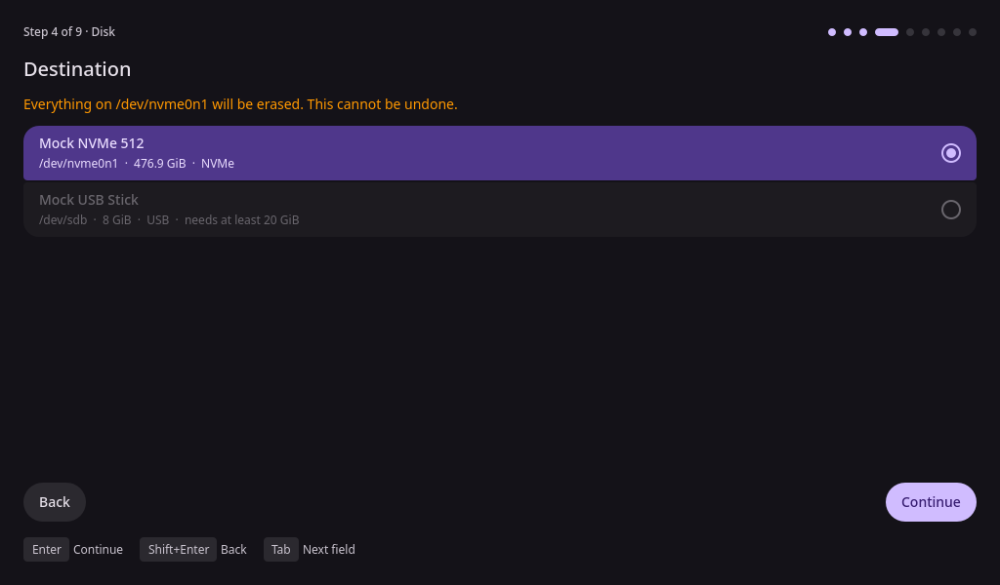
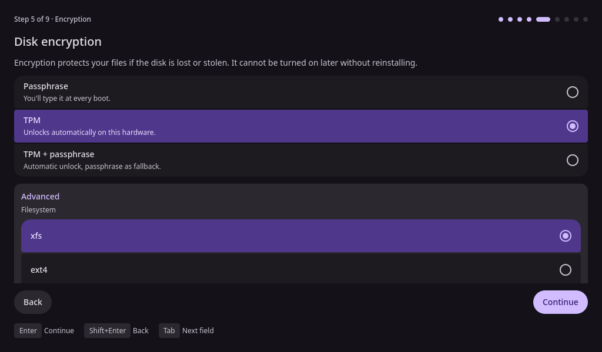
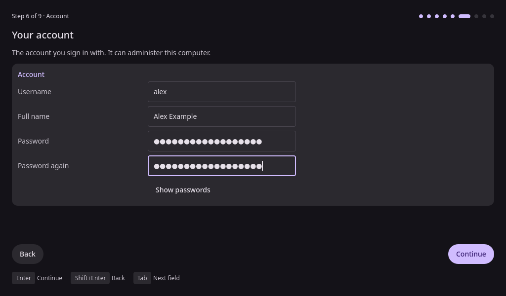
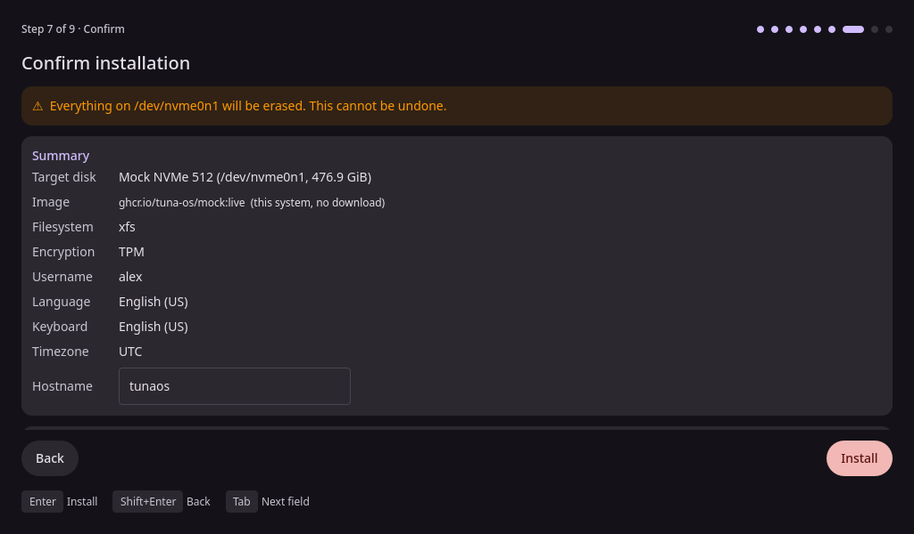
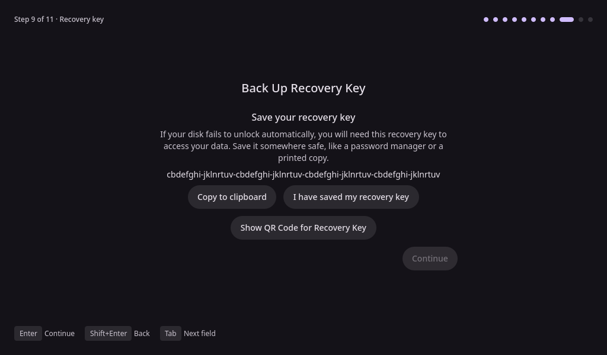
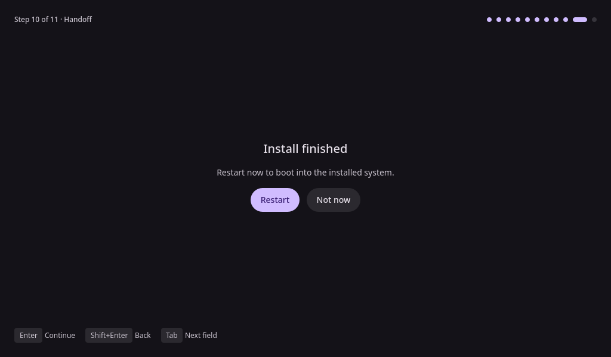
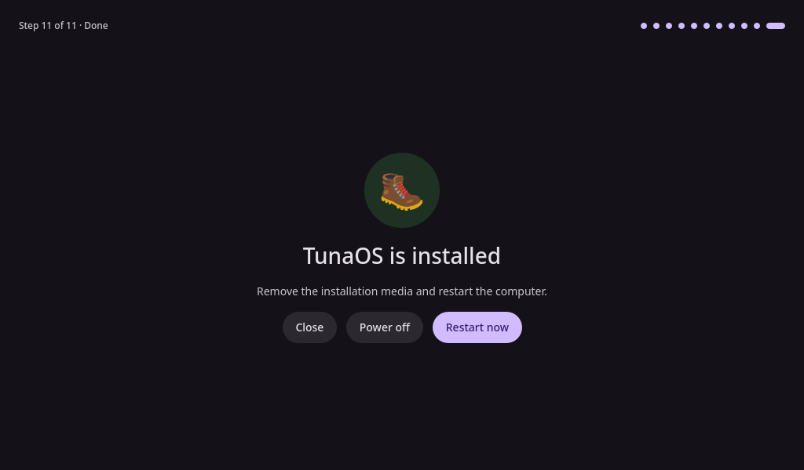

# niri: installer walkthrough, 1024 x 600

Do not edit this page. `tools/walkthrough/render.py` makes it.

These pictures come from the real installer against the mock daemon (`fishermand --mock`). The mock writes to no disk. The machine, the disks and the recovery key are fixtures.

The niri installer runs here in sway with a software renderer. niri itself needs hardware GL, but this installer is a Quickshell app that any wlroots compositor shows the same way.

| # | Page | When it shows | Picture |
|---|---|---|---|
| 1 | Try or install | The wizard runs on live media. |  |
| 2 | Session | Keyboard, language, time zone and network, on one page. |  |
| 3 | Source | The image to install. |  |
| 4 | Disk | Always. |  |
| 5 | Disk encryption | No TPM 2.0 is present. The page asks for a disk passphrase, twice. |  |
| 6 | Account | The desktop has no first-boot tool that creates the user, and the image does not make its own user. |  |
| 7 | Confirm | Always. |  |
| 8 | Recovery key | The disk is encrypted. |  |
| 9 | Handoff | After the install and the recovery key. |  |
| 10 | Done | The install ended. |  |
