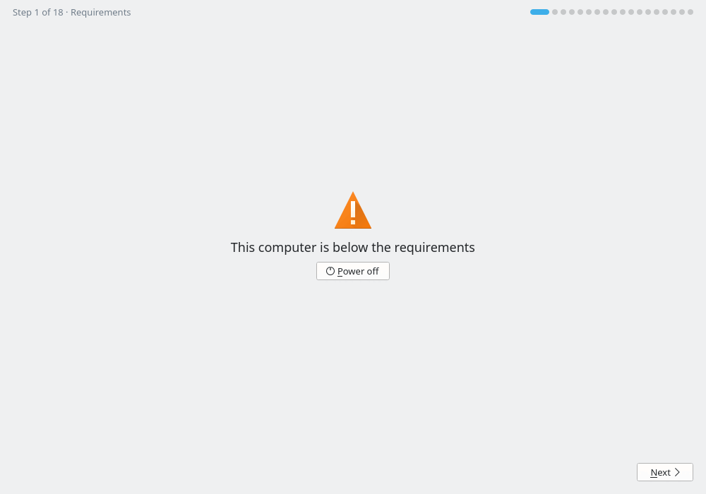

> **Part of the [bootc-installer monorepo](../../README.md).** This tree was
> `tuna-os/tuna-installer-kde` until 2026-09-17 and was imported with its history. CI for it
> lives in the root `.github/workflows/` (`screenshots-kde.yml`,
> `publish-flatpak.yml`); releases follow [`docs/RELEASE.md`](../../docs/RELEASE.md).

# TunaOS KDE Installer — Kirigami/Plasma 6 frontend for fisherman

<p align="center">
  
</p>

<p align="center">
  <em>Rendered in CI from the real wizard — see the <a href="docs/gui-walkthrough.md">walkthrough</a>.</em>
</p>


**Thin Qt 6 / Kirigami wizard** that drives the
[fisherman](https://github.com/tuna-os/fisherman) bootc install backend.

The UI is built the way KDE's own initial-setup wizard
([KISS](https://github.com/KDE/kiss), landing in Plasma 6.5) is built: each step
is a self-contained module at `modules/<name>/contents/ui/main.qml` whose root
is a `SetupModule` exposing `nextEnabled` and `contentItem`, driven by
`src/qml/Wizard.qml` with hand-rolled slide animations rather than a SwipeView.
Kirigami, Kirigami Addons (`FormCard`) and `Kirigami.Units` throughout — no
hardcoded pixel metrics, and no more forced Fusion style.

## Workflow

The wizard has the eighteen screens of `../../shared/flow/screens.yaml`, in the same order and with the same ids. A screen that has nothing to show does not show.

1. `requirements`: only while a RAM, CPU or firmware gate is unmet
2. `try-or-install`: keep the live session, or install
3. `language`, `keyboard`, `timezone`: a search field and a list each
4. `network`: only when the install needs a download
5. `prerelease`, `eula`, `rst`: only when there is something to say
6. `disk`: the disks that the backend offers
7. `wipe-or-free`: only when the chosen disk holds data (daemon backend)
8. `encryption`: a TPM 2.0 seals the disk, or you give a passphrase
9. `account`: only when no first-boot tool makes the user
10. `confirm`: each choice, and the one Install button
11. `install`: progress, Cancel, and the failure states
12. `recovery-key`: the key, with a QR code
13. `handoff`: how the installed system takes over (daemon backend)
14. `done`: installed, cancelled or failed

## Backends

`TUNA_INSTALLER_BACKEND` selects the backend. It is the same switch in the Niri, XFCE and COSMIC frontends.

| Value | Backend |
|---|---|
| `daemon` | `fishermand` over Varlink (`fisherman/docs/FISHERMAND.md`) |
| `legacy` | the `fisherman` CLI, with the recipe on stdin |
| `auto`, or not set | the daemon when its socket is there, else the CLI |

`TUNA_FISHERMAN_SOCKET` moves the `io.tunaos.Fisherman` socket. `FISHERMAND_SOCKET_DIR` moves all four sockets. `TUNA_FIRSTBOOT_TOOL=plasma-setup` (or `none`) replaces the check for `plasma-setup` on the live medium.

## Build

```bash
# Dependencies (Fedora). Kirigami and Kirigami Addons are QML-only: nothing
# links against KF6, they are resolved at runtime from the QML import path.
sudo dnf install -y cmake gcc-c++ ninja-build \
    qt6-qtbase-devel qt6-qtdeclarative-devel \
    kf6-kirigami kf6-kirigami-addons kf6-qqc2-desktop-style breeze-icons

# Build
cmake -B build -DCMAKE_BUILD_TYPE=Release
cmake --build build

# Run
./build/tuna-installer-kde
```

## Running Tests

### Backend Unit Tests

Build and execute the CTest / QtTest backend suite (`tuna-installer-backend-tests`):

```bash
cmake -B build -DCMAKE_BUILD_TYPE=Debug -DBUILD_TESTING=ON
cmake --build build
ctest --test-dir build --output-on-failure
# Or run directly:
./build/tuna-installer-backend-tests
```

### Daemon Tests

`tuna-installer-daemon-tests` drives the controller against the mock daemon, one test for each scenario. Build the mock from `tuna-os/fisherman` and give its path:

```bash
(cd <fisherman>/fisherman && go build -o /tmp/fishermand ./cmd/fishermand)
FISHERMAND_BIN=/tmp/fishermand ./build/tuna-installer-daemon-tests
```

Without the binary, the scenario tests skip and the mapping tests run. CI does not build the mock, so the scenario tests skip there.

### Screenshot Capture Harness

Build the offscreen QML screenshot capture executable (`tuna-installer-capture`):

```bash
cmake -B build -DCMAKE_BUILD_TYPE=Release -DBUILD_CAPTURE=ON
cmake --build build
./build/tuna-installer-capture
```

## Recipe

The installer writes a JSON recipe that fisherman consumes:

```json
{
  "disk": "/dev/nvme0n1",
  "filesystem": "btrfs",
  "btrfsSubvolumes": true,
  "encryption": {"type": "luks-passphrase", "passphrase": "…"},
  "image": "ghcr.io/tuna-os/albacore:gnome",
  "additionalImageStores": ["/usr/share/tuna-installer/oci-store"],
  "distroID": "tunaos",
  "selinuxDisabled": false,
  "hostname": "tunaos"
}
```

Encryption types: `none`, `luks-passphrase`, `tpm2-luks`, `tpm2-luks-passphrase`.
On a live ISO, `image` may be omitted — bootc installs the running container
(offline, no download). See the
[installer frontend contract](https://github.com/tuna-os/tunaos/blob/main/docs/INSTALLER-FRONTENDS.md)
for the shared recipe and screen contract.

## License

GPL-3.0-only
