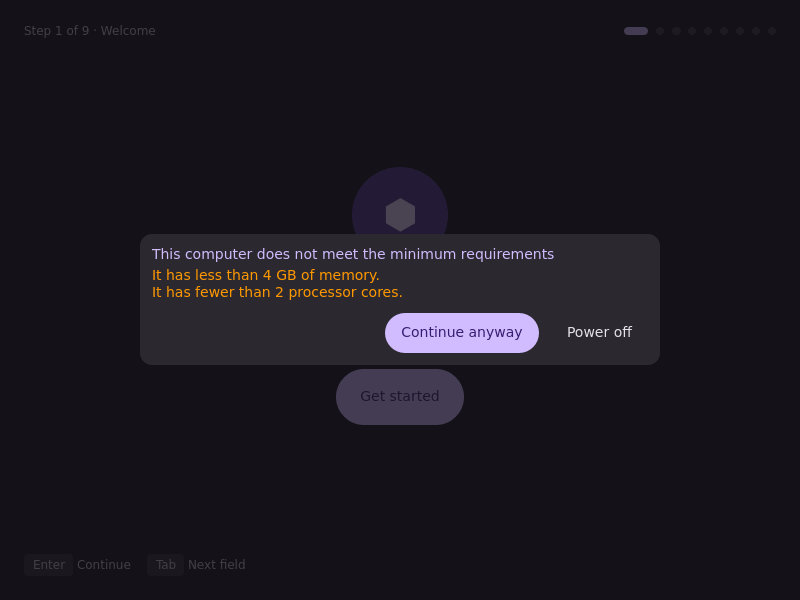

> **Part of the [bootc-installer monorepo](../../README.md).** This tree was
> `tuna-os/tuna-installer-niri` until 2026-09-17 and was imported with its history. CI for it
> lives in the root `.github/workflows/` (`screenshots-niri.yml`,
> `publish-flatpak.yml`); releases follow [`docs/RELEASE.md`](../../docs/RELEASE.md).

# TunaOS Niri Installer — Quickshell + Go installer

<p align="center">
  
</p>

<p align="center">
  <em>Rendered in CI from the real QML — see the <a href="docs/gui-walkthrough.md">walkthrough</a>.</em>
</p>


**Quickshell/QML + Go** installer for TunaOS, modeled on [DankMaterialShell](https://github.com/AvengeMedia/DankMaterialShell)'s architecture. Runs on the Niri scrollable-tiling Wayland compositor.

## Architecture

```
tuna-installer-niri/
├── ui/                    # Quickshell QML wizard and theme
├── installer/             # Go backend, offline detection, readiness, and tests
├── flatpak/               # Flatpak manifest for the packaged installer
├── tests/                 # Headless GUI capture and parity-report tooling
├── docs/gui-walkthrough.md # CI-generated screen-by-screen walkthrough
└── DESIGN.md              # Interaction and visual design specification
```

## Build

### Go backend

```bash
cd installer
go build -o tuna-installer-niri .
./tuna-installer-niri discover-disks     # the disks `fisherman probe --json` offers
./tuna-installer-niri install '{...}'     # run fisherman with a JSON recipe
```

### QML frontend

Requires [Quickshell](https://quickshell.org/):

```bash
quickshell ui/installer.qml
```

## Workflow

1. **Welcome**: the first screen. An unmet RAM, CPU or UEFI requirement
   stops the wizard here. For RAM and CPU you can continue. For UEFI you
   can only power off or open the firmware setup.
2. **Session**: the keyboard, language and time zone of the live session,
   and the network (`session-get`, `session-set`). The wizard sends only
   the fields that you changed. A failure is a warning, and the wizard
   continues. Off live media these fields are read-only. Nothing here goes
   into the recipe.
3. **Source**: the live system, or one row for each leaf of the catalog.
   Offline images are first. Each row shows the product and the channel,
   and a search box filters the list. The wizard selects the image that
   `default_image` names in `branding.json`, then in the catalog. If no file
   names one, you must select a row. When the image needs a download and
   the network check fails, Continue stays off. The page then shows
   **Network settings** and **Recheck**.
4. **Disk**: the disks from `tuna-installer-niri discover-disks`, which
   prints the disks of `fisherman probe --json`
   (`../../shared/probe/README.md`).
5. **Encryption**: the LUKS and TPM choices, and the filesystem under
   Advanced. The filesystem list and its first value come from the image.
   A reveal button shows the passphrase.
6. **Account**: the first user. You type the password two times, and a
   reveal button shows the two fields. The wizard has no account step when
   the image sets `needs_user_creation` to `false`.
7. **Confirm**: the summary and the hostname field.
8. **Install**: the output of the backend, a **Copy log** button and the
   path of the log file. **Cancel** and the window close button ask first.
9. **Done**: one of three results: installed, cancelled or failed. An
   installed system shows the recovery key, the restart button, the power
   dialog and the tour slides of the image.

## The catalog

`tuna-installer-niri catalog` reads the image catalog and follows
`../../shared/catalog/README.md`. It tries these files in order:

1. `<etc>/bootc-installer/images.json`
2. `<etc>/tuna-installer/images.json`
3. `$XDG_CONFIG_HOME/bootc-installer/images.json`
4. the catalog in the package

`<etc>` is `/etc`. In a Flatpak it is `/run/host/etc`. A file that does not
parse does not stop the search. `FISHERMAN_IMAGES_PATH` puts one file in
front of the list for a test.

For each leaf the command prints the recipe keys for this computer:
`image`, `targetImgref`, `bootloader`, `composeFsBackend`, `flatpaks`,
`flatpakVarPath` and `imageType`. The QML copies them into the recipe. On a
computer with an NVIDIA GPU, a leaf with `nvidia_imgref` installs that
image. The backend never downloads a Flatpak list. For a list that it
cannot read offline it writes no `flatpaks` key.

## How the backend runs fisherman

`installer/offline.go` has the one function that finds fisherman:

| Where | Binary | Install command |
|---|---|---|
| Native | `/usr/local/bin/fisherman` | `pkexec` |
| Live media | `/usr/local/bin/fisherman` | `sudo -n` |
| Flatpak | `$XDG_CACHE_HOME/bootc-installer/fisherman` | `pkexec` on the host |

In a Flatpak the backend copies `/app/bin/fisherman` to that path. It then
asks the host for the SHA256 of the copy. If the host does not give the
same value, nothing runs. `probe`, `validate` and `install` all use this
binary.

The backend ends `install` with the exit code of fisherman. Code 130 is a
cancelled install.

## The account groups

The QML sends no groups. The backend writes the default list of
`../../shared/account/groups.json`, which `installer/groups.json` copies. An
ISO builder replaces the list with `user.groups` in
`<etc>/bootc-installer/recipe.json`.

## Translation

Each line of text is in `qsTr()`, or comes from a copy key of
`branding.json` through `root.text()`. `installer/i18n_test.go` fails on a string in `ui/*.qml` that
is in neither. No translation file ships yet.

## Parity notes

- The phone companion is only in the GNOME frontend.
- Keyboard, language and time zone apply to the live session only
  (`localectl` and `timedatectl` on the host). The pinned fisherman has no
  recipe keys for them, so the installed system keeps the defaults of the
  image.

## DBus Integration

For tighter QML ↔ Go integration (future), expose the backend as a DBus service:

- Service: `org.tunaos.Installer`
- Object: `/org/tunaos/Installer`
- Methods: `DiscoverDisks()`, `StartInstall(disk, hostname)`, `PollOutput()`, `PollStatus()`

## License

GPL-3.0-only

## Offline installs

`tuna-installer-niri detect` prints the live image and the offline images
from the probe as JSON. On live media the Source step offers the system
that runs, with no download. It also marks each catalog row whose image is
offline. The recipe has no `additionalImageStores`: fisherman finds the
stores of the host.

## Testing

### Go Backend Unit Tests

```bash
cd installer
go test ./...
```

### Headless UI Screenshot Capture & Verification

The capture shows each page of the UI and tests it. It needs no Wayland compositor and no Quickshell:

```bash
pip install PyQt6
python3 tests/gui/capture-screens.py docs/screenshots
```

## Contributing

Please see [CONTRIBUTING.md](CONTRIBUTING.md) for development workflows, testing requirements, and guidelines.

## Development

```bash
cd installer && go build -o tuna-installer-backend .
TUNA_BACKEND=$PWD/tuna-installer-backend quickshell -p ../ui/installer.qml
```

## Flatpak

```bash
# The manifest builds fisherman from the submodule.
git -C ../.. submodule update --init fisherman
flatpak-builder --user --install --force-clean build flatpak/org.tunaos.InstallerNiri.json
flatpak run org.tunaos.InstallerNiri
```

