# The TunaOS niri installer — a walkthrough

Every image here is rendered in CI from the real `ui/installer.qml` by
`tests/gui/capture-screens.py`, so it cannot drift from the app.

**How this is possible without a compositor.** The installer normally runs under
[Quickshell](https://quickshell.org/) on niri, which is why it has been so hard
to look at. The capture loads the *same, unmodified* `installer.qml` under a
plain Qt Quick runtime by supplying local stub implementations of the two
Quickshell modules it imports (`tests/qml-stubs/`). The UI is real; only the
process-spawning backend is canned.

That stub is also a safety boundary: the real backend runs fisherman, which
partitions a disk. A stub that actually executed `command` would repartition
whatever machine rendered the docs.

---

## 1. Welcome

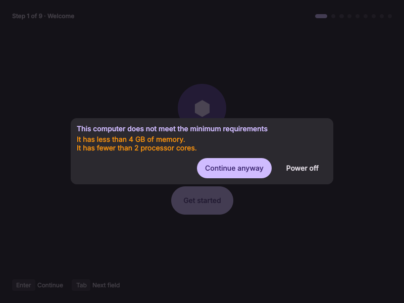

The capture shows the requirements gate. It stops the wizard until you
accept it.

## 2. Session

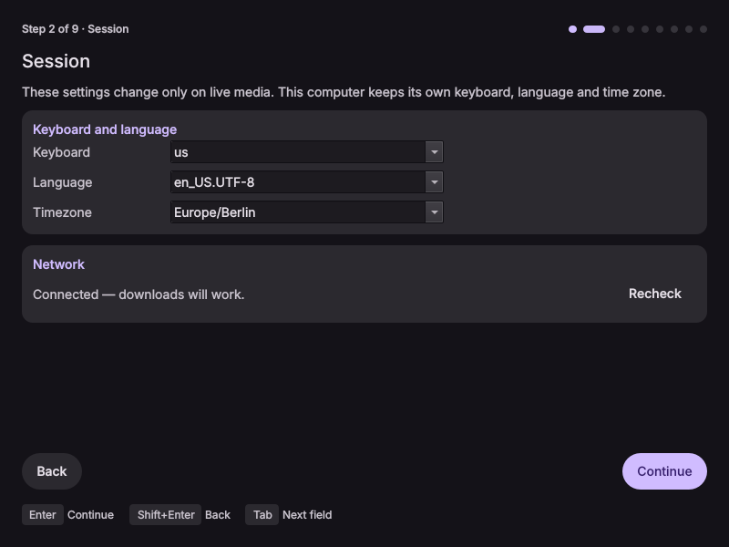

The keyboard, language and time zone of the live session. The wizard sends
only the fields that you changed. Off live media the fields are read-only,
as in this capture.

## 3. Source

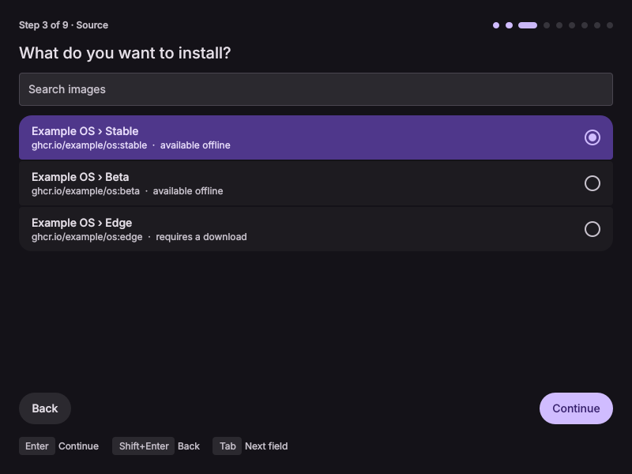

Each row shows the product and the channel. The search box filters the list.

## 4. Disk

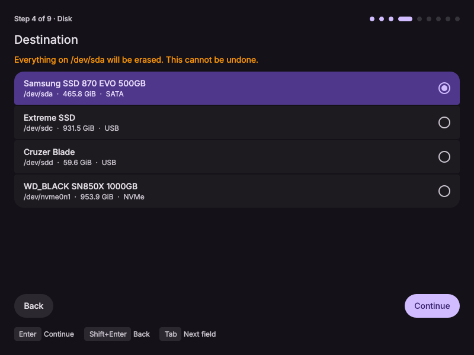

The disks come from `tuna-installer-niri discover-disks`, which reads
`fisherman probe --json`.

## 5. Encryption

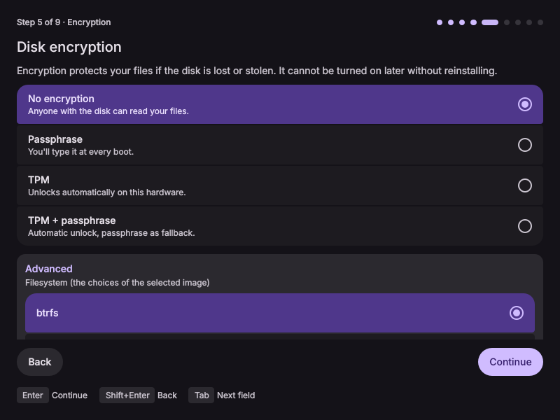

The filesystem choices under Advanced come from the selected image.

## 6. Account

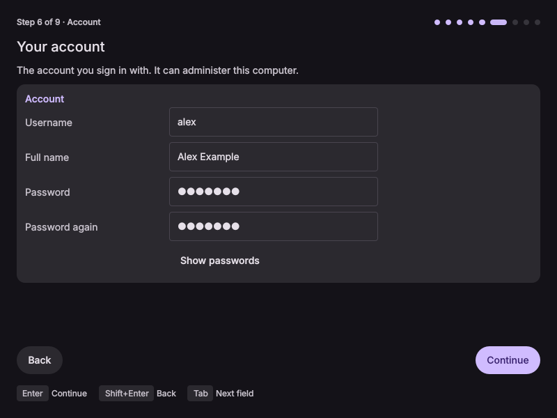

The first user. Continue stays off until fisherman accepts the username
(`validate --json --partial`) and the two passwords are the same.

## 7. Confirm

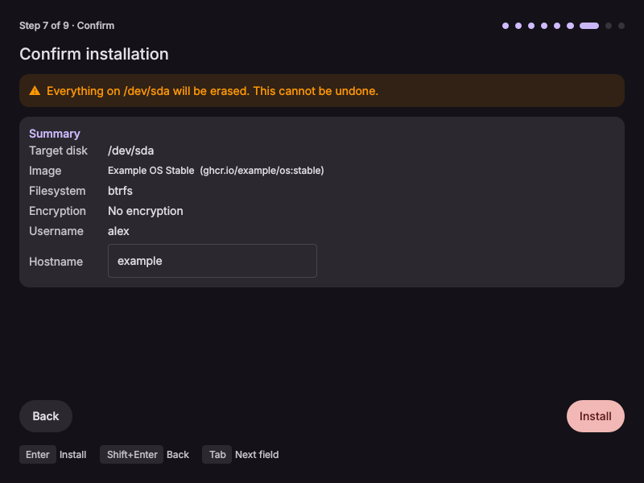

The last screen before the install writes to the disk.

## 8. Install

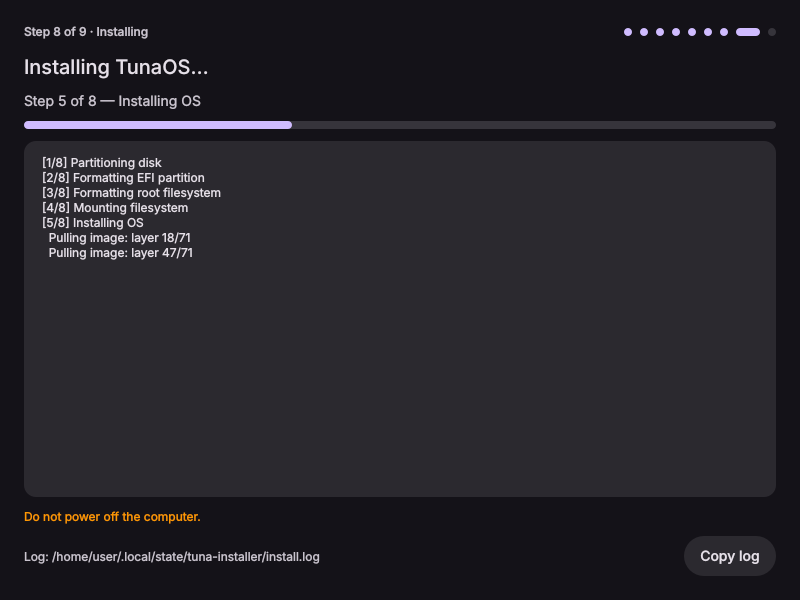

The output of the backend goes into the log.

## 9. Done

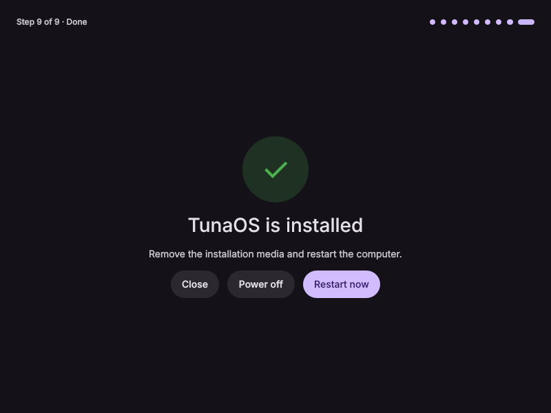

## 10. Recovery key

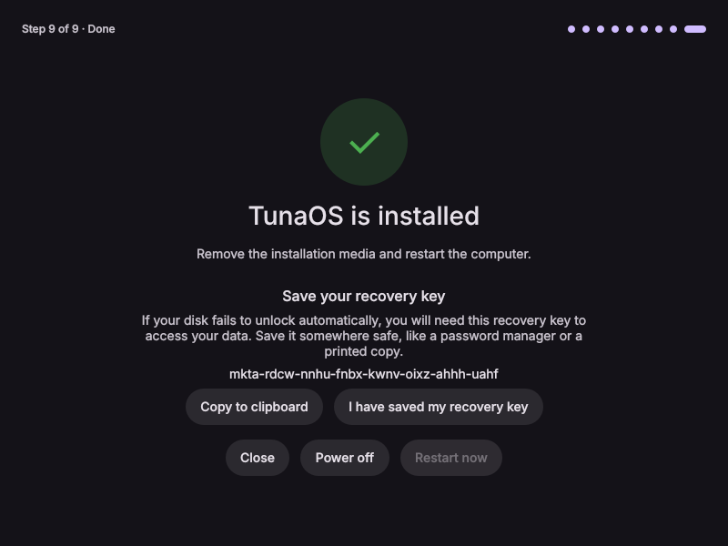

A TPM install shows the recovery key. Restart stays off until you confirm
that you saved the key.

## 11. Tour

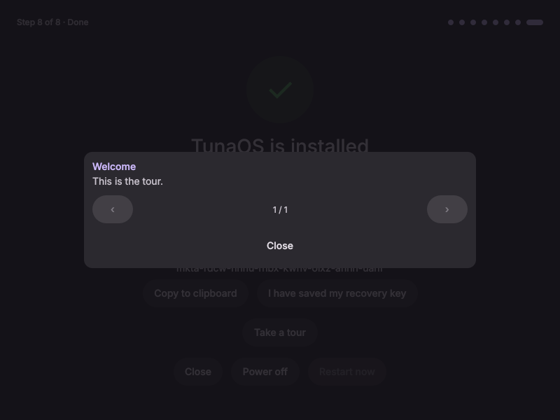

## 12. Cancel asks first

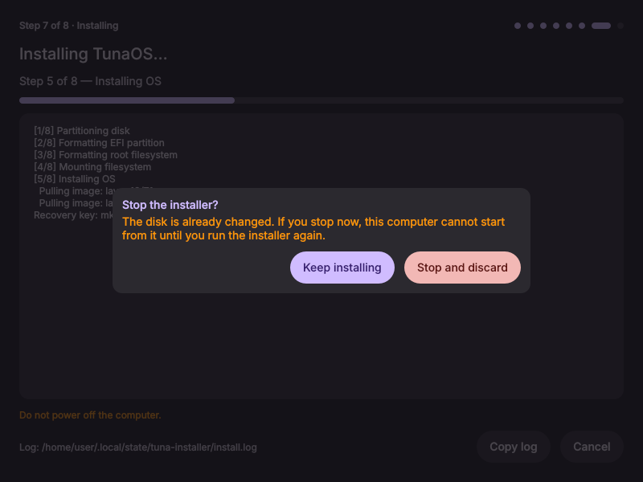

Cancel and the window close button open this dialog. The install continues
until you confirm.

## 13. Cancelled

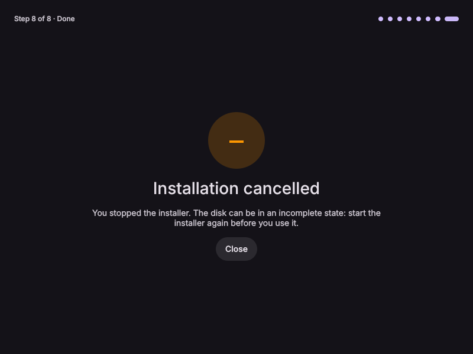

## 14. Offline

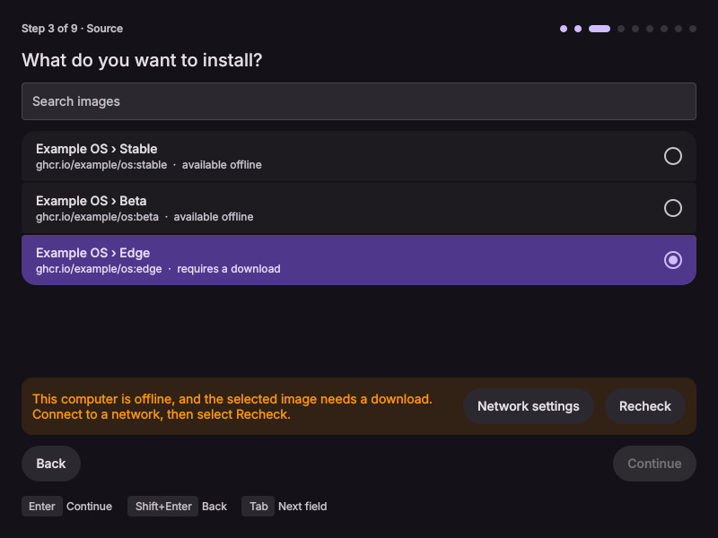

The selected image needs a download and the network check failed. Continue
stays off.

---

## Running the UI yourself, without niri

```sh
pip install PyQt6
python3 tests/gui/capture-screens.py /tmp/shots
```

Or load it interactively with the same stubs on `QML2_IMPORT_PATH`.
