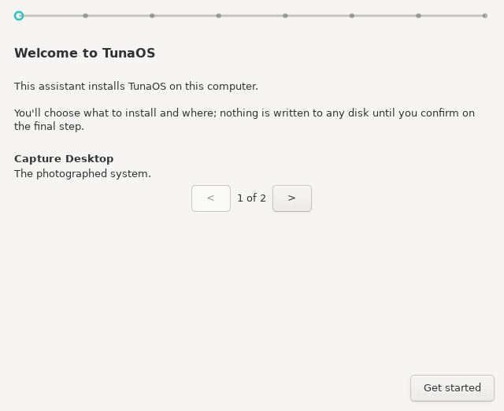

> **Part of the [bootc-installer monorepo](../../README.md).** This tree was
> `tuna-os/tuna-installer-xfce` until 2026-09-17 and was imported with its history. CI for it
> lives in the root `.github/workflows/` (`screenshots-xfce.yml`,
> `publish-flatpak.yml`); releases follow [`docs/RELEASE.md`](../../docs/RELEASE.md).

# TunaOS XFCE Installer — GTK3 frontend for fisherman

<p align="center">
  
</p>

<p align="center">
  <em>Every frame is generated in CI from the real wizard — see the
  <a href="docs/gui-walkthrough.md">step-by-step walkthrough</a>.</em>
</p>

Classic GTK3/PyGObject wizard that drives the
[fisherman](https://github.com/tuna-os/fisherman) bootc install
backend. The plainest of the TunaOS installer frontends by design — see
`DESIGN.md` (the trawl line is the entire brand budget) and the
[shared installer frontend contract](https://github.com/tuna-os/tunaos/blob/main/docs/INSTALLER-FRONTENDS.md).

## Flow

Welcome (with a tour of the image families) → Source (image catalog with a
search box, offline tags, "install this system" on live media) → Destination
→ Disk encryption (filesystem under Advanced) → Identity (hostname, account,
keyboard layout for this session) → Confirm (connectivity gate when the
install must download the image) → Progress (with Cancel) → Done.

- A machine below the minimum does not get the wizard. A RAM, CPU or UEFI
  gate shows first, with Continue anyway or Power off.
- The image catalog follows `shared/catalog/README.md`. The page selects the
  branding `default_image`, then the catalog `default_image`. If the catalog
  has neither, the page selects nothing and Next waits.
- The account password is typed two times. Each secret field has a reveal
  icon. The account gets the groups of `shared/account/groups.json`.
- The keyboard layout applies to the live session only. The recipe has no
  locale, keyboard or time zone field yet.
- When the connectivity check fails, the confirm page offers Network
  settings and Recheck, and holds the Install button.
- Cancel on the progress page asks first. A window close during an install
  asks too. A cancelled install gets its own result page.
- `--autoinstall RECIPE_JSON` skips the wizard. fisherman validates the
  recipe first, and a recipe that it rejects starts nothing.

Live media and offline images are fisherman's facts (`fisherman probe
--json`). On live media an empty `image` installs the system that runs. The
recipe never carries `additionalImageStores`.

## Run (development)

```bash
# Dependencies (Fedora)
sudo dnf install -y python3-gobject gtk3

./tuna-installer-xfce
```

`core.fisherman_command()` is the one function that decides how fisherman
runs:

- Outside a Flatpak: `bash -c 'pkexec /usr/local/bin/fisherman -; exit $?'`.
  On live media it uses `sudo -n` in place of `pkexec`.
- In a Flatpak: the app copies its bundled `/app/bin/fisherman` to
  `$XDG_CACHE_HOME/bootc-installer/fisherman`, compares the SHA256 on the
  host, and runs that copy through `flatpak-spawn --host`.

The recipe goes to fisherman on stdin. The bash wrapper makes the parent of
fisherman a process that this frontend owns, because fisherman cancels when
its parent dies.

## Testing

Run unit tests via `pytest`:

```bash
pytest tests/
```

Or via Python's built-in `unittest`:

```bash
python3 -m unittest discover tests/
```

Headless GUI screenshot capture and verification:

```bash
python3 tests/gui/capture-screens.py docs/screenshots
```

## Contributing

Please see [CONTRIBUTING.md](CONTRIBUTING.md) for local setup, testing workflows, and PR submission guidelines.

## Flatpak

```bash
# The manifest builds fisherman from the submodule.
git -C ../.. submodule update --init fisherman
flatpak-builder --user --install --force-clean build \
  flatpak/org.tunaos.InstallerXfce.json
flatpak run org.tunaos.InstallerXfce
```

Runtime is `org.gnome.Platform` (ships GTK3 + PyGObject; the app uses no
libadwaita and follows the system GTK theme).

## License

GPL-3.0-or-later

