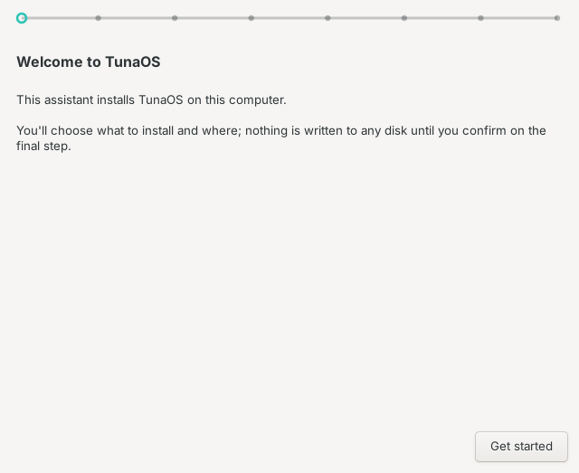
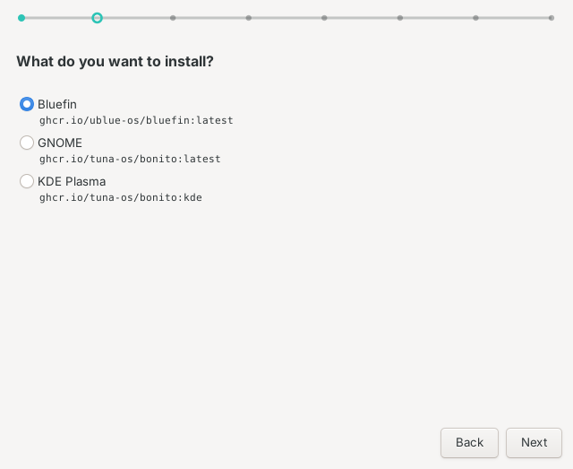
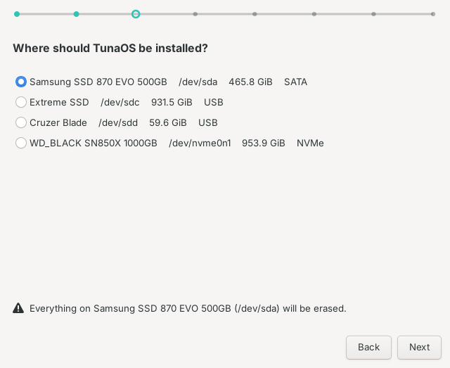
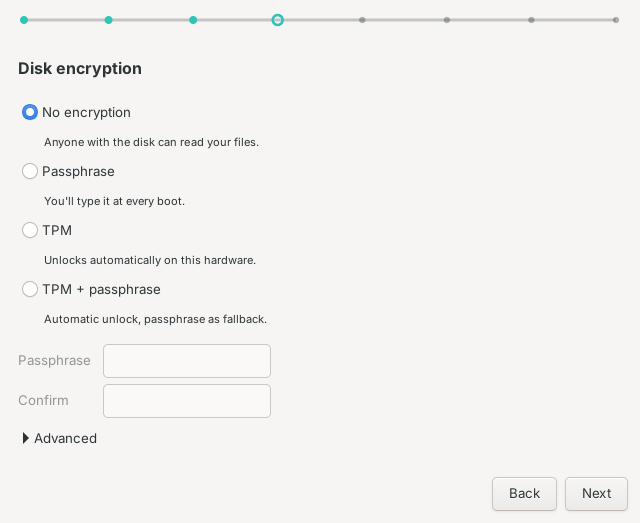
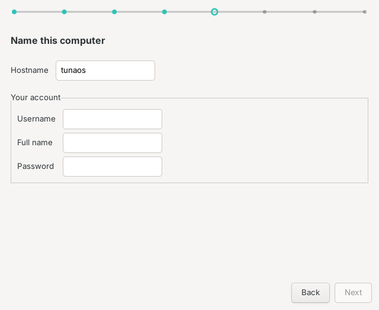
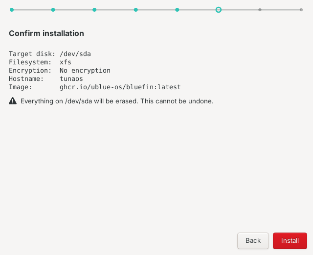
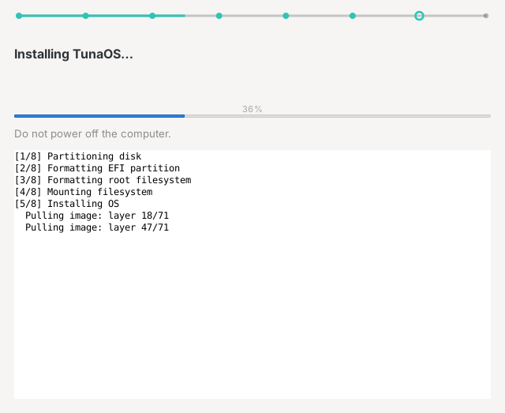
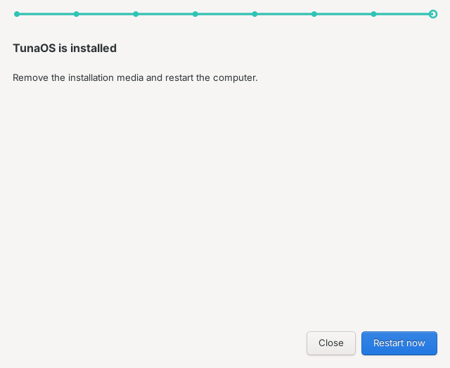
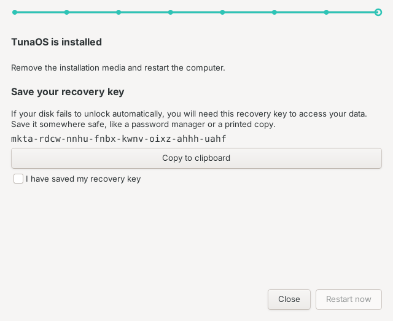

# Installing TunaOS with the XFCE installer — a walkthrough

This is what the installer looks like, screen by screen. Every image on this
page is generated in CI from the real GTK3 wizard by
`tests/gui/capture-screens.py`, so it cannot drift from the app the way
hand-taken screenshots do.

The capture runs headless under Xvfb against fixtures — a canned image catalog
and the shared `fisherman probe --json` fixture (`shared/probe/fixtures/laptop.json`)
— so it never touches a real disk and the output is reproducible.

---

## 1. Welcome



Nothing is written to any disk until you confirm on the final step. The dotted
line across the top is the progress indicator for the whole wizard. There is
no Back button here: there is nothing to go back to.

## 2. What to install



Each entry is a bootc image. The tree groups variants under their base image,
so picking a desktop is one choice rather than a search through tags.

## 3. Where to install it



Only real, non-removable disks are offered, and the live medium you booted from
is excluded — so the installer will not offer to overwrite itself.

## 4. Disk encryption



The passphrase fields stay disabled until you choose an option that needs one.
Filesystem and btrfs subvolume layout live under **Advanced**, because the
default is right for nearly everyone.

## 5. Your account



The computer name becomes the hostname. The account created here is an
administrator on the new system.

## 6. Confirm



The last screen before anything is written, and the only one whose button is
styled as destructive. The summary lists the target disk, filesystem,
encryption, hostname and image (and the account, when the image needs one),
the same rows as the KDE, COSMIC and Niri confirm pages, and the
`confirm_warning` line names the disk that will be erased. Everything above
this point is reversible by quitting.

## 7. Installing



The log is visible by default — XFCE users want the output. The step label and
progress bar are driven by fisherman's JSON progress protocol
(`shared/progress/README.md`) rather than a timer, so the bar reflects real
progress rather than an estimate. The Back/Next bar is gone: an install
cannot be backed out of.

## 8. Done



"<product> is installed" (`done_title`), then remove the installation medium
and restart (`done_subtitle`). The page has its own **Close** and
**Restart now** buttons in place of Back/Next.

## 9. Done, after a TPM install



fisherman prints a recovery key after TPM enrolment. It stays on the done page
with a copy button, and **Restart now** stays insensitive until "I have saved
my recovery key" is ticked.

---

## Regenerating these

```sh
sudo apt-get install -y python3-gi python3-gi-cairo gir1.2-gtk-3.0 xvfb imagemagick
xvfb-run -a python3 tests/gui/capture-screens.py docs/screenshots
```

The script reads its own output back and fails if a screen did not really
render — too few distinct colours, a near-uniform flat fill, or no text. That
check exists because a capture rig which only asserts its PNGs *exist* will
happily publish blank pages: the files are present and non-empty, and the
pages are empty.

It also waits for GTK to actually paint each page before grabbing it. GTK3
paints from its frame clock, on a timed source, so "no events pending" does
not mean "drawn": the harness used to stop there, and CI committed the source
page as the destination frame, the identity page as the confirm frame and the
progress page as the done frame, while the widget-tree text still credited
every screen. The grab now waits for two `after-paint` frames and an X sync,
theme animations are off, and a frame that is pixel-identical to the one
before it, a stack showing the wrong page, Back in the wrong place, a confirm
summary missing a row or the erase warning, or a done page without its title,
Close and Restart now all fail the job.
